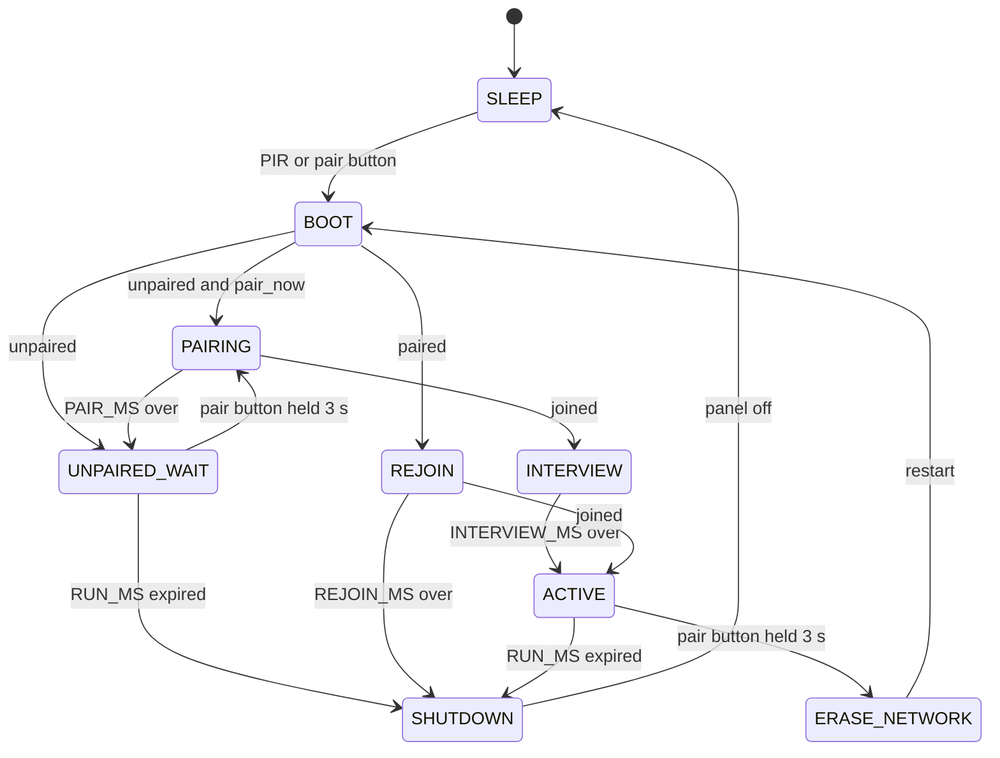

# Greenlight: design (draft for review)

Status: draft, 2026-10-12 (rev 4). Implemented and tested on the hardware: the e-paper driver, the pin
move, and plan step 1 (inputs, state machine, simulated sleep; Zigbee stubbed, see 3.5 and 12).

## 1. Goal

A battery-powered Zigbee device with a 4.2" 400x300 e-paper panel that shows Home Assistant's list of
"problems" (doors and windows left open, lights left on, ...). Each line is a text (an icon later), e.g.
`Living room door open`. An empty list shows a full-screen "All OK" graphic instead. A small footer shows
when the screen was last confirmed up to date.

The device sleeps (deep sleep) whenever nobody is around and is alive and live-updating while someone is
looking at it. The PIR sensor and the pair button are the only things that wake it, and the PIR (or the button) keeps it awake. Pairing to a Zigbee network
comes first: an unpaired device does nothing useful until it is paired.

## 2. Overview

```
  HA (template sensor: lines + hash)       Zigbee2MQTT (generic mapping)               device
  ──────────────────────────────────       ──────────────────────────────              ──────
  current_hash ─┐                                                                      PIR on -> wake
                │   awake / shown_hash  <── standard cluster reports <───────────────  rejoin, report
  automation:   │                                                                      ...
  awake && shown_hash != current_hash ─►  /set {"write": ...} ─► attribute writes ──► collect lines, commit,
                                                                                        redraw, report shown_hash
                                                                                       PIR off + timeout
                                         awake=false  <──────────────────────────────  report, deep sleep
```

Principles:

- **Push from HA, state from the device.** The device never asks for data. It exposes `awake` and
  `shown_hash`; HA pushes whenever the device is awake and stale.
- **Snapshots, not deltas.** Every push is the complete list, so a lost, repeated or late frame never
  leaves lasting damage, and a device that slept through any number of changes catches up in one push.
- **The panel is the memory.** The e-paper keeps its image without power (but see the MVP full clear in
  3.4).
- **The device is dumb.** HA writes the final text; the device only lays out lines.

## 3. Device behaviour

### 3.1 Inputs

| Input | Pin | Meaning |
|---|---|---|
| PIR | D0 (GPIO0) | "somebody is around". The button on D0 simulates it: pressed = PIR active. Active-low button vs. active-high PIR: polarity behind one macro. A deep-sleep wake pin (GPIO0-7). |
| Pair button | D1 (GPIO1), see 10 | also a deep-sleep wake source. Active-low, internal pull-up. A 3 s hold (`RESET_HOLD_MS`) does the one thing it is for, with no feedback while holding: unpaired, it starts pairing; paired, it clears the network and starts pairing. Short presses only wake the device. |

"Activity" below means: PIR active **or** pair button pressed. Either one wakes the device from sleep, and
either one holds the `RUN_MS` timeout. The 3 s hold is measured from when the button went down; a button
still held from the wake-up counts from boot. So one continuous 3 s hold from sleep is enough, both to
start pairing (unpaired) and to reset the network (paired).

### 3.2 Timeouts

| Name | Value | Meaning |
|---|---|---|
| `RUN_MS` | 5 s | activity timeout. Held at full while the PIR is active or the pair button is pressed, counts down after it is released, re-armed by any new activation. At 0 the device shuts down. |
| `PAIR_MS` | 180 s | length of the pairing window. |
| `INTERVIEW_MS` | 60 s | time to stay awake after joining, for the Z2M interview. |
| `RESET_HOLD_MS` | 3 s | pair button hold: start pairing (unpaired) or clear the network and start pairing (paired). |
| `REJOIN_MS` | 15 s | give up a rejoin after this long (MVP budget assumption is 3 s, see 3.6). |

### 3.3 State machine

Pairing comes before PIR-driven behaviour. At every boot or wake the device first asks "am I paired?".
Only a paired device runs the PIR-driven part. An unpaired device only waits for the pair button; activity
(PIR or button) just keeps it awake while it waits. Pairing starts on a 3 s hold, same as the network reset.



(Mermaid: renders on GitHub and in VS Code with a Mermaid preview extension. The table below says the same
thing in text.)

States and transitions:

| State | What it does | Leaves when |
|---|---|---|
| **SLEEP** | nothing runs | PIR active or pair button pressed -> BOOT |
| **BOOT** | init, read the stored snapshot and `shown_hash` from retained memory (empty after a cold boot: `shown_hash = 0`), check the stack for a stored network | paired -> REJOIN; unpaired and `pair_now` flag set -> PAIRING (flag cleared); unpaired -> UNPAIRED_WAIT |
| **UNPAIRED_WAIT** | shows the "press the pair button" screen; `RUN_MS` runs as usual (activity keeps it awake, so the hold can complete) | pair button held `RESET_HOLD_MS` -> PAIRING; `RUN_MS` expired -> SHUTDOWN |
| **PAIRING** | network steering; ignores the PIR; shows the pairing screen | joined -> INTERVIEW; `PAIR_MS` over -> "Pairing failed" screen, back to UNPAIRED_WAIT |
| **INTERVIEW** | awake and answering Z2M; ignores the PIR; reports `awake` and `shown_hash` so HA can already push | `INTERVIEW_MS` over -> ACTIVE |
| **REJOIN** | restores the network from NVS and rejoins; the stored snapshot is on screen | joined -> ACTIVE; `REJOIN_MS` expired -> SHUTDOWN |
| **ACTIVE** | listens continuously, receives pushes, redraws, reports; heartbeat every 30 s; `RUN_MS` as in 3.2 | `RUN_MS` expired -> SHUTDOWN; pair button held `RESET_HOLD_MS` -> ERASE_NETWORK |
| **ERASE_NETWORK** | polite leave, erase the Zigbee storage, clear the stored snapshot and `shown_hash`, set the `pair_now` flag, restart | restart -> BOOT (-> PAIRING) |
| **SHUTDOWN** | finish any refresh, final clean refresh (clear, then render the current snapshot), report `awake = false` (best effort), `epd_poweroff()` | -> SLEEP; if an input is already active, the next wake is immediate |

Rules that keep it simple:

- One timer per state, no hidden state elsewhere. The only things that survive SLEEP are the retained
  data (stored snapshot, footer, `shown_hash`, `pair_now`) and the Zigbee network in NVS.
- The pair button is only acted on in UNPAIRED_WAIT and ACTIVE, both times as a 3 s hold. In every other state it is ignored, apart from waking the device.
- A failed pairing never erases anything; the device stays factory new.
- A failed rejoin never erases the network; only the pair button does.

### 3.4 MVP panel handling (full clear, optimize later)

On every wake (BOOT), the panel gets a full clear (so the controller has a valid previous frame for
partial updates, see CLAUDE.md), then the stored snapshot and stored footer are rendered right away, in
parallel with the rejoin. When HA pushes a changed snapshot or a fresh footer, the screen is partially
refreshed once more. Consequence: the screen flashes once per wake. The stored snapshot (lines + footer,
well under 1 KB) lives in retained RAM, since the 15 KB framebuffer does not fit. Optimizations for later:

- O1: do not touch the panel on wake if nothing changed (clear lazily, only when a redraw is needed).
- O2: skip the final clean refresh at SHUTDOWN when no partial update happened since the last one.
- O3: persist the snapshot in NVS so it survives a battery change.

### 3.5 Current code (plan step 1 done)

`main/hello_world_main.c` implements the state machine of 3.3 and the timeouts of 3.2:

- inputs (D0, D1) are polled and debounced by a task, level based; `RUN_MS` = 5 s;
- all states exist; Zigbee is stubbed (join succeeds after 3 s, rejoin after 1 s, the pairing-window-over
  path is therefore not exercised); ERASE_NETWORK only clears the NVS flags;
- `paired` and `pair_now` are in NVS; SLEEP is the simulation of 3.6;
- each state shows a placeholder word (WAIT, PAIR, FAIL, INTERVIEW, REJOIN, ERASE); ACTIVE still runs the
  ONE..TEN refresh test instead of the real content;
- `INTERVIEW_MS` is **10 s for development** (design value 60 s): set it back before real use.

Tested on the board: unpaired start (no press: shutdown, still unpaired; press: pairing), 3 s hold erase and
re-pair, wake by PIR and by pair button, hold keeps awake, re-arm during the countdown, 2 s hold does not
erase. A factory-new device: erase the NVS partition (command in CLAUDE.md).

### 3.6 MVP sleep simulation and rejoin budget

Deep sleep is the last step. Until then a top-level loop simulates it:

```
app_main():  BOOT -> ... -> SHUTDOWN -> sleep_wait_for_wake() -> esp_restart()
```

- `sleep_wait_for_wake()` blocks until the PIR input (D0) or the pair button is active. In the final
  firmware it is replaced by `esp_deep_sleep_start()` with both pins as wake sources (the wake-up status
  register tells which one fired, though BOOT only needs the pin levels); nothing else changes.
- `esp_restart()` makes the next cycle run the complete real boot path: stack init, restore from NVS, rejoin.
  Only retained RAM and NVS carry over, as after a real deep-sleep wake. It is not known whether
  retained RAM (`RTC_DATA_ATTR`) survives a software restart on the C6; the MVP assumes it does not and
  keeps those few fields (stored snapshot, footer, `shown_hash`, `pair_now`) in NVS. At the final deep-sleep
  step they can move to retained RAM to save flash writes.
- The radio stays powered during the simulated sleep, so the power numbers mean nothing yet; the
  functional behaviour (cold stack start, rejoin, resync via `shown_hash`) is the same.

**Rejoin time.** A web search found no measured wake-to-rejoin number for the ESP32-C6 with the
esp-zigbee-sdk, and some reports of lengthy commissioning after leaving deep sleep. MVP budget: assume 3 s
(range 1-3 s) in the latency table and treat `REJOIN_MS` = 15 s as the hard limit. The real number is the
first thing to measure when Zigbee runs: log the time from boot to the "joined" signal over many wakes.

## 4. Pairing details

- **Detecting "no network"**: the esp-zigbee-sdk signal `ESP_ZB_BDB_SIGNAL_DEVICE_FIRST_START` means
  factory new, `..._DEVICE_REBOOT` means a network was restored from NVS. (BOOT uses it; this is why
  BOOT cannot finish before the stack has reported.)
- **PAIRING** runs BDB network steering with retries for `PAIR_MS`. The user enables "Permit join" in
  Zigbee2MQTT meanwhile. Panel: static "Pairing..." screen.
- **INTERVIEW**: Z2M reads Basic cluster attributes and so on (several seconds, sometimes tens). The Basic
  cluster must report the fixed manufacturer name `Greenlight` and model id (6.1); they are what Z2M
  stores, and what a converter would match later. HA can already push the first snapshot (`shown_hash = 0` differs from `current_hash`).
- **ERASE_NETWORK**: a polite leave (`esp_zb_bdb_reset_via_local_action()` in the SDK), then erase the
  Zigbee storage (`esp_zb_factory_reset()`, which restarts the chip), after setting `pair_now` so the next
  BOOT goes straight to PAIRING. The SDK function names are from memory; verify when implementing.
- **Z2M side**: after a reset, Z2M may still list the old device. A re-pair with the same IEEE address
  works as a rejoin; to start clean, remove the device in Z2M first.
- The reset is done with the device awake; the pair button itself wakes it, so one continuous 3 s hold from sleep is enough.

## 5. Data model

### 5.1 Snapshot (HA side, logical)

```json
{ "hash": 48213,
  "lines": [ {"icon": "door",   "text": "Living room door"},
             {"icon": "window", "text": "Kitchen window"} ],
  "footer": "Updated 14:32" }
```

- `hash`: **24-bit** value chosen by HA, identifying the content of `lines` (e.g. the first 6 hex digits of
  a sha1 / md5 of icon+text of every line; 24 bits so it travels exactly in a float, see 6.4). The device
  stores and echoes it; it never computes it. The same lines always give the same hash.
  The footer is **not** part of the hash (it changes every minute and must not cause a push by itself).
- `lines`: **at most 6**, already sorted and truncated by HA; if the list is longer, the sixth is
  "+N more". Text is plain ASCII for the MVP (no accents), about 21 characters at most (see 8).
- Empty `lines` means "All OK".
- `icon`: kept in the format as a 1-byte number for later, **ignored by the MVP** (the device draws
  text only).
- `footer`: a short text (about 30 bytes), written by HA.

### 5.2 Staleness footer

The screen is only as fresh as the last wake. The footer is the fix: HA sends a footer with the current
time **every time the device reports `awake = true`** and with every content push. Its meaning is "the last
time this screen was confirmed in sync with HA". If the time is old, the viewer knows the data may be old.

- The footer is a separate attribute write (`footer`, 6.5), not tied to a hash change.
- The device stores the footer text with the snapshot and redraws it with the next refresh. Footer and
  lines that arrive close together are coalesced into one refresh (debounce about 300 ms).
- The footer sits in a reserved strip at the bottom of the screen (about 20 px), also on "All OK".

### 5.3 State exposed by the device

Section 6.4 defines `awake` and `shown_hash` (standard Binary Input / Analog Input clusters) next to the
battery and occupancy attributes. `shown_hash` after a redraw is the acknowledgement of a push.

## 6. Zigbee data model (freeze before the first pairing)

Goal: the first pairing is the last one, **and the MVP works with no external converter**. Z2M keeps what
the interview found in `data/database.db` (endpoints, cluster lists, a few Basic attributes). Everything that
lives there must be final before the first pairing. Everything else (exposed names, units, custom attributes
added later) can change without re-pairing.

### 6.1 Freeze rules

1. **Identity never changes:** `manufacturerName` = `Greenlight`, `modelId` = `greenlight-eink42` (the
   Basic strings are at most 32 characters). A new hardware variant gets a new model id, never a changed one.
2. **One endpoint (1), profile Home Automation, device id Simple Sensor (0x000C)**, and the cluster list in
   6.3 is final, including the clusters that are declared but not fully used yet (OTA client).
3. **No reporting configuration from Z2M.** The device sends all reports on its own, to the coordinator
   (0x0000), so nothing depends on Z2M's bind / Configure Reporting step succeeding on a sleeping device.
4. **Attribute ids are append-only.** Never reuse or renumber one.
5. Z2M availability is disabled for the device. `last_seen` (updated by every report) is the liveness signal
   and doubles as "last wake".

### 6.2 External converter: what it is, why it exists, and whether we need one

**What it is.** Z2M itself only speaks "Zigbee"; for each device model it needs a *definition*: a small
JavaScript object (in Z2M's built-in database, or in a file you add under `external_converters/`) that says
(a) how to recognise the model (`modelId` / manufacturer), (b) which entities it exposes to MQTT / Home
Assistant, (c) how to turn incoming Zigbee messages into state (`fromZigbee`), (d) how to turn MQTT
commands into Zigbee frames (`toZigbee`), and (e) how to bind / configure reporting. An **external
converter** is such a definition that you supply yourself for a device Z2M does not know. In Z2M 2.11+ it
must also be enabled with `enable_external_js`.

**Why one is normally needed.** Z2M ships definitions for known products, plus a best-effort generic
mapping for unknown devices: it discovers the *standard* clusters a device declares and maps those to
features (battery, occupancy, temperature, on/off, ...), logs a warning that the device is not supported, and
shows what it found in the device's *Exposes* tab. What a generic mapping cannot do is understand
**custom clusters**: state in a manufacturer-specific cluster is not published, and nothing in Z2M knows how
to build a custom command from your data. A converter is the way to teach it that.

**Our decision: no converter in the MVP.** This design is built so that the generic mapping suffices:

- All *state* the HA side needs is in **standard clusters** (6.4): battery in Power Configuration, the PIR in
  Occupancy Sensing, `awake` in Binary Input, `shown_hash` in Analog Input.
- All *input* to the display is plain **attribute writes** to a custom cluster, which Z2M can send itself
  through the documented raw `write` message on `zigbee2mqtt/<device>/set` (6.5). No custom command and no
  custom converter code is involved. The Z2M documentation describes this raw read / write as meant for
  development and debugging, which is acceptable for a first version; it does mean HA publishes a verbose
  JSON message instead of a friendly one.

**What is not verified** (to check at the first pairing, in this order):

1. Which entities the generated mapping creates for Binary Input and Analog Input, and under which names
   (the documentation only promises the standard ZCL features; battery and occupancy are expected). If they
   are not exposed, the state never reaches HA.
2. Whether the raw `write` accepts a cluster given only by its numeric id (0xFC8A) with attributes outside
   the ZCL specification given as `{"value": ..., "type": 66}`. The documentation shows this form for
   attributes; for a cluster id Z2M does not know it does not say.

**Fallback if either fails: a very small converter, with no firmware change and no re-pairing.** The
clusters are already declared on the device (frozen), so a converter only adds knowledge on the Z2M side
(`numeric` / `binary` entries for the standard clusters, and/or `deviceAddCustomCluster` for 0xFC8A). It
would be a file of about twenty lines, and it can be added at any time without touching the cache. This is
why the design can promise a final first try even though the "no converter" part is not proven.

### 6.3 Endpoint 1 clusters

| Cluster | Direction | Role |
|---|---|---|
| Basic 0x0000 | server | identity, power source, firmware version |
| Power Configuration 0x0001 | server | battery (6.6) |
| Occupancy Sensing 0x0406 | server | the PIR as an HA presence sensor |
| Binary Input 0x000F | server | `awake` (`presentValue`) |
| Analog Input 0x000C | server | `shown_hash` (`presentValue`) |
| `greenlight` custom 0xFC8A | server | the display input slots (6.5), writable by the coordinator |
| OTA Upgrade 0x0019 | client | reserved for a later firmware update, so the cluster list never changes. Not implemented yet. |

(Housekeeping clusters the SDK needs, such as Identify, are fine.) 0xFC8A was picked arbitrarily; check it
does not collide with a cluster zigbee-herdsman already names. It is used **without** a manufacturer code in
the ZCL frames (the id is in the manufacturer-specific range 0xFC00-0xFFFF); if the first test shows the SDK
or Z2M insists on one, adding it is a firmware change (and a raw-write option) only.

### 6.4 State: device to HA (standard clusters, all reported by the device itself)

| Cluster / attribute | Type | Meaning |
|---|---|---|
| Power Configuration `batteryPercentageRemaining` 0x0021 | uint8, **0-200 = 0-100 %** | battery charge (MVP: always 200) |
| Power Configuration `batteryVoltage` 0x0020 | uint8, units of 100 mV | battery voltage (MVP: always 42) |
| Power Configuration `batteryAlarmState` 0x003E | bitmap32 | low-battery flags (MVP: 0) |
| Occupancy Sensing `occupancy` 0x0000 | bitmap8, bit 0 | the PIR is active; `occupancySensorType` 0x0001 = 0 (PIR) |
| Binary Input `presentValue` 0x0055 | bool | **`awake`**: joined and listening, can receive pushes |
| Analog Input `presentValue` 0x0055 | single float | **`shown_hash`**: hash of the snapshot on the panel (0 = nothing known) |

**The hash is 24 bits** (0 to 16777215), so it travels exactly in a single-precision float; HA computes it
from the list text however it likes (any stable 24-bit hash, e.g. the first 6 hex digits of an md5 / sha1 of
the joined lines). The device stores and echoes it; it never computes it.

Percent note (known pitfall, kept for the real battery code): the ZCL percentage is in half percents, and Z2M
divides by 2, so 100 % is the raw value 200.

**When the device reports.** There is nothing periodic while asleep. On each wake, after (re)join, in this
order, so HA sees fresh data before the push decision: (1) Power Configuration (the three battery attributes
in one frame); (2) Occupancy; (3) Analog Input `shown_hash`; (4) Binary Input `awake` = true **last**. The
automation is triggered by `awake`, and by then `shown_hash` is already current. While awake: `awake` +
`shown_hash` every 30 s (heartbeat); `shown_hash` after each redraw; `occupancy` when the PIR changes. At
SHUTDOWN: `awake` = false, best effort.

### 6.5 Input: HA to device (writes to the custom cluster 0xFC8A)

All attributes are writable character strings (type 0x42) except the commit, which is uint32 (0x23).

| Id | Name | Content |
|---|---|---|
| 0x0000 - 0x0005 | `line1` .. `line6` | `HHHHHH\|text`: the snapshot's 24-bit hash as 6 hex digits, a bar, then the ASCII text (about 21 characters). An empty string clears the slot. |
| 0x0006 | `footer` | the footer text, ASCII, no tag |
| 0x0007 | `commit` | `count * 16777216 + hash` (uint32): the number of lines (0-6) in the top byte, the 24-bit hash below |

Why it looks like this:

- **Plain attribute writes**: the SDK delivers them to the application as "attribute set" events; no
  custom command handler is needed, and Z2M's raw write is a stock feature.
- **One line per slot, written in any order**: each write is a small separate frame (about 30 bytes of
  payload), so nothing is fragmented and nothing depends on the order the frames arrive.
- **The tag and the commit make it safe.** The device keeps the lines it received with their tag. When it
  gets `commit`, it renders only if lines 1 to `count` are all present and tagged with that hash; then it stores the snapshot, reports `shown_hash`
  and redraws. Otherwise it ignores the commit, `shown_hash` does not change and HA resends after 5 s. A
  lost or reordered frame can therefore never display a mix of old and new lines under a new hash.
- `count = 0` is the "All OK" screen; a commit whose hash equals `shown_hash` is ignored.
- `footer` is best effort and may be written before or after the commit; it is redrawn with the next
  refresh. The icon is not carried at all in the MVP (see 5.1).

Example (HA publishes these to `zigbee2mqtt/<device>/set`; ids in decimal, the format of the Z2M raw write):

```json
{"write": {"cluster": 64650, "payload": {"0": {"value": "A1B2C3|Living room door", "type": 66},
                                         "1": {"value": "A1B2C3|Kitchen window", "type": 66}}}}
{"write": {"cluster": 64650, "payload": {"7": {"value": 44151491, "type": 35}}}}
```

(64650 is 0xFC8A; the commit value is 2 * 16777216 + 0xA1B2C3. Exact JSON details, such as whether a
value is a string or a number array, are to be confirmed at the first test.)

### 6.6 Battery

Hardware: a single 1000 mAh LiPo cell with a protection circuit (the cell is cut off by the protection board
before it is damaged, around 2.5-3 V). **MVP: no real battery handling.** The device just reports 100 %
(`batteryPercentageRemaining` = 200, `batteryVoltage` = 42, `batteryAlarmState` = 0) once per wake. The static
Power Configuration attributes are set from the start: `batterySize` 0x0031 = 2 (Other), `batteryQuantity`
0x0033 = 1, `batteryRatedVoltage` 0x0034 = 37 (3.7 V), `batteryAHrRating` 0x0032 = 100 (units of 10 mAh).

Conventions the real implementation will follow (from the zigbee-herdsman-converters `battery()` helper): Z2M
names are `battery` (%), `voltage` (mV) and `battery_low` (binary, true = low), all diagnostic entities;
there is no `battery_ok`. HA's battery binary sensor also reads on = low. The `voltage` entity has only 100 mV
resolution via the standard attribute (too coarse for a LiPo: 3.0-4.2 V is 12 steps), which is why exact mV
is on the future-work list below.

### 6.7 Future work (after the MVP; none of this is in the MVP firmware)

These were considered and deliberately dropped from the MVP. Append-only ids are reserved so they can be
added later without a re-pair (attributes of the custom cluster only show up in HA with a converter; see
6.8).

| Reserved id (0xFC8A) | Name | Type | Meaning |
|---|---|---|---|
| 0x0010 | `join_time_ms` | uint16 | boot to joined of the latest wake (the rejoin-time measurement, Q1) |
| 0x0011 | `wake_reason` | enum8 | 0 cold boot, 1 PIR, 2 pair button, 3 other / unknown |
| 0x0012 | `last_awake_s` | uint16 | duration of the previous wake cycle, for battery life insight |
| 0x0013 | `battery_mv` | uint16 | exact battery voltage, exposed under the name `voltage` |
| 0x0014 | `panel_error` | enum8 | 0 ok, 1 panel init failed, 2 refresh failed, 3 BUSY timeout |

Also future: real battery measurement (ADC on a spare pin, e.g. D2 / GPIO2, with a high-value divider and a
capacitor at the pin; first check whether the XIAO ESP32-C6 already has a battery sense path), a LiPo
percentage curve and low-battery thresholds, measured once per wake before the radio and the panel start;
OTA; and a converter if the generic mapping is not good enough.

### 6.8 If a converter is needed later

Outline only (file under `external_converters/`, `enable_external_js` on, file name and API to be checked
against the installed Z2M):

```js
import {battery, occupancy, deviceAddCustomCluster} from 'zigbee-herdsman-converters/lib/modernExtend';
export default {
    fingerprint: [{modelID: 'greenlight-eink42', manufacturerName: 'Greenlight'}],
    model: 'greenlight-eink42', vendor: 'Greenlight', description: 'E-paper problem list',
    extend: [
        deviceAddCustomCluster('greenlight', {ID: 0xFC8A, attributes: {...}, commands: {}, commandsResponse: {}}),
        battery({percentage: true, voltage: false, lowStatus: true, percentageReporting: false, voltageReporting: false}),
        occupancy(),
        /* numeric / binary entries for the Analog Input and Binary Input presentValue, named shown_hash and awake */
    ],
    toZigbee: [ /* optional: one "snapshot" JSON {hash, lines[], footer} -> the writes of 6.5 */ ],
};
```

The `toZigbee` part would turn a friendly JSON message into the writes of 6.5, so HA does not have to
publish raw write messages. None of it changes the device.

### 6.9 If the cache bites anyway

Cheapest first: restart Z2M (it reloads definitions); correct the Z2M side and republish; remove the device in
Z2M and pair again (hold the pair button 3 s: the device erases its network and pairs, section 4); as a last
resort delete the device entry from `data/database.db` with Z2M stopped. The Z2M frontend also has a
re-interview action (from memory: verify), which needs the device awake, hence the 60 s `INTERVIEW_MS`.

## 7. Home Assistant / Zigbee2MQTT

- **No external converter in the MVP** (6.2). Z2M's generic mapping exposes the standard-cluster state
  (`battery`, `occupancy`, and, to be verified at the first pairing, `awake` / `shown_hash` from Binary
  Input / Analog Input). Z2M logs a warning that the device is not supported; that is expected. Disable Z2M
  availability for this device (for battery devices it only trips after hours, so it says nothing useful).
  Fallback, if the generic mapping hides `awake` / `shown_hash` or refuses the raw write: the small
  converter of 6.8, no device change.
- **HA template sensor**: builds the sorted, truncated `lines` (max 6), the 24-bit `current_hash` and the
  footer text.
- **HA automation**, triggered by any change of `awake`, `shown_hash` or `current_hash`:
  - on `awake` becoming true: write the footer (current time); if `shown_hash != current_hash`, also the
    snapshot
  - while `awake` is true and `shown_hash != current_hash`: publish the writes of 6.5 to
    `zigbee2mqtt/<device>/set` (the tagged lines in a few small writes, then the `commit`); wait about 5 s;
    if `shown_hash` still differs, resend (a few retries at most)
  - debounce a few seconds after `current_hash` changes, so a burst of events gives one refresh.
- `awake` is considered true only if the last report is younger than about 90 s (covers a device that
  died without saying goodbye).
- The MQTT entity names for `awake` and `shown_hash` are whatever Z2M's generic mapping produces; read them
  from the device's Exposes tab after the first pairing and put them into the automation.

## 8. Display (MVP)

- 400x300, 1 bit. Current partial refresh ~470 ms; see CLAUDE.md for panel quirks (ghosting, grain).
- ASCII only, no accents, no icons in the MVP. The existing 5x7 font (only the test glyphs) is extended
  to printable ASCII. At scale 3 a character is 18 px advance x 21 px high: about 21 characters per line
  across 384 px.
- 6 rows of about 46 px (text vertically centered or top-aligned in the row) plus a footer strip of about
  20 px at the bottom, smaller font (scale 2).
- Static screens as full-screen drawings: "All OK", "Press the pair button", "Pairing...", "Pairing
  failed". For the MVP these can be drawn with the same text routine.
- Later: Hungarian accents (Latin Extended-A font from a TTF at build time) and icons (1-bit bitmaps
  indexed by the wire icon number, about 24x24, text shifted right).

## 9. Failure modes

| Situation | Behaviour |
|---|---|
| Frame lost | HA resends after 5 s; the device ignores repeats of the hash it already shows. |
| Device sleeps mid-update | Partial buffer dropped; next wake reports the old `shown_hash`, HA pushes again. |
| HA down / Zigbee down | Screen keeps the stored snapshot; its footer time stops advancing, so the staleness shows. |
| Rejoin fails (parent gone) | After `REJOIN_MS` the device shuts down with the stored snapshot on screen; network kept. |
| Parent forgot the device | Slower full rejoin on wake. Set the end-device timeout as long as the stack allows. |
| Device dies silently | `awake` expires in HA after about 90 s. |
| Pairing fails | "Pairing failed" screen, UNPAIRED_WAIT; still factory new. |
| Frame counter | Must persist across deep sleep or the parent rejects the device. The SDK persists it; verify. |
| Cold boot (battery change) | Retained RAM empty: blank snapshot, `shown_hash = 0`, HA pushes on join. |

## 10. Pins

Both wake inputs must be deep-sleep wake pins, which on the ESP32-C6 are GPIO0-7 (on the XIAO header: D0,
D1, D2). The panel's DC and RST lines were moved off D1/D2 for that reason (done).

| Pin | Use |
|---|---|
| D0 (GPIO0) | button now (simulates the PIR), PIR output later; wake pin |
| D1 (GPIO1) | **pair button** (`PAIR_BUTTON_PIN`), to GND, internal pull-up; wake pin |
| D2 (GPIO2) | free (spare wake pin) |
| D3 (GPIO21) | panel BUSY |
| D4 (GPIO22) | panel DC |
| D5 (GPIO23) | panel RST |
| D8, D9, D10 | panel SCK, CS, MOSI |

The panel pins are held low before power-off (existing code); that works on any GPIO. Avoid D6/D7 (UART0)
in case the console moves there. Because the pair button is already on its final wake pin, the MVP uses
D1 as well (earlier drafts said D4).

## 11. Decisions so far and open questions

Decided: `RUN_MS` 5 s; `PAIR_MS` 180 s; `INTERVIEW_MS` 60 s; 3 s hold, no feedback; MVP full clear; no
accents and no icons; 6 lines; PIR's own hold time is ignored; deep sleep simulated by a top-level loop;
PIR and pair button both wake the device; the pair button is on D1 (panel DC/RST moved to D4/D5, done);
retained RAM assumed not to survive a software restart (NVS in the MVP).

Also decided (rev 5): manufacturer name `Greenlight`; no external converter in the MVP (generic Z2M mapping +
raw attribute writes, section 6); state in standard clusters (Power Configuration, Occupancy, Binary Input,
Analog Input), 24-bit hash; battery is a fixed 100 % in the MVP (single 1000 mAh LiPo with protection
circuit); `join_time_ms`, `wake_reason`, `last_awake_s`, `panel_error` and a real battery measurement are
future work (6.7).

Open:

- **Q1** Real rejoin time (measure once Zigbee runs; until `join_time_ms` exists, from the serial log).
- **Q2** Retained RAM across deep sleep is fine on the C6; across `esp_restart()` it is unverified. Only
  matters for flash wear, not for correctness.
- **Q3** At the first pairing, in this order: what Z2M's generic mapping exposes for Binary Input / Analog
  Input and under which names; whether the raw `write` to cluster 0xFC8A with typed attribute ids works; and
  whether the SDK / Z2M accept the custom cluster without a manufacturer code (6.2, 6.3). Each has a
  fallback that needs no re-pairing.
- **Q4** OTA: the reserved OTA client cluster (6.3) is declared now so the cluster list never changes; the
  partition table (two app slots in 2 MB) is a later, USB-flashed change.
- **Q5** Whether the SDK lets the device be rx-on-when-idle only while awake; fallback is a short poll
  interval (100-200 ms) while awake, a long one otherwise.

## 12. Implementation plan

Functionality first, the renderer last. Until the renderer exists, a received snapshot is stored, logged
on the serial port and acknowledged exactly as if it had been drawn (`shown_hash` is reported); the panel
keeps showing the placeholder words.

1. **Done.** Level-based PIR/button timeout with `RUN_MS` = 5 s, polarity macros, state machine with Zigbee
   stubbed, pair button on D1, 3 s hold to pair or reset, simulated sleep with NVS.
2. **Next: Zigbee.** The frozen data model of section 6, no converter: identity (`Greenlight` /
   `greenlight-eink42`), endpoint 1 with the clusters of 6.3, the reports of 6.4 (fixed 100 % battery,
   occupancy, `shown_hash`, `awake`, in that order), the slot attributes and commit of 6.5 (tagged lines,
   store the snapshot and footer in NVS, "render" = log + report `shown_hash`), pairing, interview, rejoin,
   rx-on-when-idle while awake, heartbeat, real leave and erase in ERASE_NETWORK. Make the failure paths
   testable (pairing window over, rejoin failed). Set `INTERVIEW_MS` back to 60 s. Measure the rejoin time.
3. **HA side and first pairing checks:** pair with Z2M and settle Q3 (what is exposed, whether the raw writes
   work); then the HA template sensor (lines, `current_hash`, footer), the push-on-stale automation with
   retries, `awake` expiry. Add the small converter of 6.8 only if Q3 requires it. Measure end-to-end
   latency. Disable Z2M availability for the device.
4. **Proper deep sleep:** wake on D0 and D1 (replace `st_sleep`), retained state in retained RAM. Then the
   optimizations O1-O3.
5. **Renderer (last):** full-ASCII font (replace the 5x7 test glyphs), 6 rows plus footer strip, static
   screens (All OK, press the pair button, pairing, pairing failed) replacing the placeholder words,
   event-driven redraw in ACTIVE instead of the ONE..TEN test, redraw of the stored snapshot after the MVP
   full clear in BOOT. Later: accents and icons, and the future work of 6.7 (diagnostics, real battery handling).
