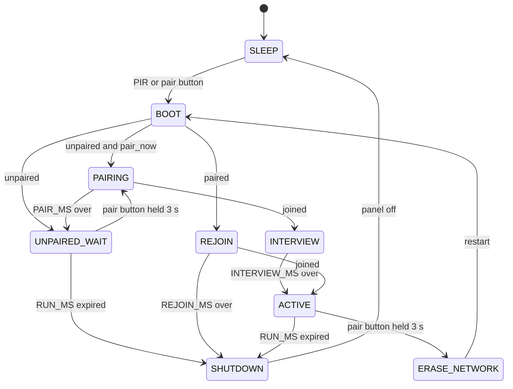

# Greenlight: design (draft for review)

Status: draft, 2026-10-27 (rev 6). Implemented and tested on the hardware: the e-paper driver, the pin
move, and plan step 1 (inputs, state machine, simulated sleep; Zigbee stubbed, see 3.5 and 12).

Rev 6 replaces the snapshot of text lines (6 tagged lines + footer + commit, 8 writes per push) with a
**dataset + view** model (5, 6.5). The dataset is the fixed list of possible lines, synced rarely. The view is
a bitfield over it, sent in **one frame** per wake. Reason: after a wake, Zigbee frames to and from the device
are lost at about 5 to 7 % each, and each loss costs about 13 s of Z2M recovery. 6-line pushes stalled in 8 of
20 wakes, single-frame pushes in 2 of 39 (ZIGBEE_PAYLOAD.md 7.2). Implemented (plan step 2b): 34 of 39
wakes got their view in 0.09-1.26 s (ZIGBEE_PAYLOAD.md 7.2).

## 1. Goal

A battery-powered Zigbee device with a 4.2" 400x300 e-paper panel that shows Home Assistant's list of
"problems" (doors and windows left open, lights left on, ...). Each line is a text (an icon later), e.g.
`Living room door open`. An empty list shows a full-screen "All OK" graphic instead. A small footer shows
when the screen was last confirmed up to date.

The device sleeps (deep sleep) whenever nobody is around and is alive and live-updating while someone is
looking at it. The PIR sensor and the pair button are the only things that wake it, and the PIR (or the button) keeps it awake. Pairing to a Zigbee network
comes first: an unpaired device does nothing useful until it is paired.

## 2. Overview

```
  HA (dataset: all possible lines,          Zigbee2MQTT (generic mapping)              device
      view: which are active now)
  ─────────────────────────────────        ─────────────────────────────              ──────
                                                                                      PIR on -> wake
  automation <──── wake counter   <──────── standard cluster report <──────────────── rejoin, report wake
  dataset_hash (cached) != HA's?  ───────►  /set: ds_entry x N, ds_commit  ─────────► store dataset (rare)
  every wake, and on any change   ───────►  /set: one view write (1 frame) ─────────► redraw lines + footer,
                 shown_view_id    <──────── standard cluster report <──────────────── report shown_view_id
                                                                                      PIR off + timeout
                 awake=false      <──────────────────────────────────────────────────  report, deep sleep
```

Principles:

- **Push from HA, state from the device.** The device never asks for data. It exposes `awake`,
  `shown_view_id` and `dataset_hash`; HA pushes on every wake and whenever its view changes while awake.
- **One frame per wake.** Every Zigbee frame right after a wake can stall the exchange for about 13 s
  (ZIGBEE_PAYLOAD.md 7.2), so the per-wake exchange is one report up and one write down. Everything that
  needs more frames (the dataset) is rare and checked by a hash.
- **Full views, not deltas.** Every view push is the complete bitfield, so a lost, repeated or late frame
  never leaves lasting damage, and a device that slept through any number of changes catches up in one push.
- **The panel is the memory.** The e-paper keeps its image without power (but see the MVP full clear in
  3.4).
- **The device is dumb.** HA writes the final text (in the dataset) and decides which lines are active and
  in which order they appear; the device only lays them out.

## 3. Device behaviour

### 3.1 Inputs

| Input | Pin | Meaning |
|---|---|---|
| PIR | D0 (GPIO0) | "somebody is around". The button on D0 simulates it: pressed = PIR active. Active-low button vs. active-high PIR: polarity behind one macro. A deep-sleep wake pin (GPIO0-7). |
| Pair button | D1 (GPIO1), see 10 | also a deep-sleep wake source. Active-low, internal pull-up. A 3 s hold (`RESET_HOLD_MS`) does the one thing it is for, with no feedback while holding: unpaired, it starts pairing; paired, it clears the network and starts pairing. Short presses only wake the device. |

"Activity" below means: PIR active **or** pair button pressed. Either one wakes the device from sleep, and
either one holds the `RUN_MS` timeout. The 3 s hold is measured from when the button went down; a button
still held from the wake-up counts from boot. So one continuous 3 s hold from sleep is enough, both to
start pairing (unpaired) and to reset the network (paired).

### 3.2 Timeouts

| Name | Value | Meaning |
|---|---|---|
| `RUN_MS` | 20 s | activity timeout (was 5 s: too short to see a push arrive after a wake, which can take about 20 s). Held at full while the PIR is active or the pair button is pressed, counts down after it is released, re-armed by any new activation. At 0 the device shuts down. |
| `PAIR_MS` | 180 s | length of the pairing window. |
| `INTERVIEW_MS` | 60 s | time to stay awake after joining, for the Z2M interview. |
| `RESET_HOLD_MS` | 3 s | pair button hold: start pairing (unpaired) or clear the network and start pairing (paired). |
| `REJOIN_MS` | 15 s | give up a rejoin after this long (MVP budget assumption is 3 s, see 3.6). |
| `VIEW_WAIT_MS` | 45 s | ACTIVE does not shut down before this long (from entering ACTIVE) while no view has been applied in this wake, so a write that Z2M lost can still arrive as HA's resend (7). Covers HA's 20 s acknowledgement timeout plus one more 13 s Z2M recovery. Costs battery only in wakes without a view (HA or Zigbee down). |

### 3.3 State machine

Pairing comes before PIR-driven behaviour. At every boot or wake the device first asks "am I paired?".
Only a paired device runs the PIR-driven part. An unpaired device only waits for the pair button; activity
(PIR or button) just keeps it awake while it waits. Pairing starts on a 3 s hold, same as the network reset.



(Mermaid: renders on GitHub and in VS Code with a Mermaid preview extension. The table below says the same
thing in text.)

States and transitions:

| State | What it does | Leaves when |
|---|---|---|
| **SLEEP** | nothing runs | PIR active or pair button pressed -> BOOT |
| **BOOT** | init, read the stored dataset and view from NVS (none after an erase: `dataset_hash = 0`, `shown_view_id = 0`), check the stack for a stored network | paired -> REJOIN; unpaired and `pair_now` flag set -> PAIRING (flag cleared); unpaired -> UNPAIRED_WAIT |
| **UNPAIRED_WAIT** | shows the "press the pair button" screen; `RUN_MS` runs as usual (activity keeps it awake, so the hold can complete) | pair button held `RESET_HOLD_MS` -> PAIRING; `RUN_MS` expired -> SHUTDOWN |
| **PAIRING** | network steering; ignores the PIR; shows the pairing screen | joined -> INTERVIEW; `PAIR_MS` over -> "Pairing failed" screen, back to UNPAIRED_WAIT |
| **INTERVIEW** | awake and answering Z2M; ignores the PIR; reports the wake state (6.4) so HA can already sync the dataset and push the view | `INTERVIEW_MS` over -> ACTIVE |
| **REJOIN** | restores the network from NVS and rejoins; the stored view is on screen | joined -> ACTIVE; `REJOIN_MS` expired -> SHUTDOWN |
| **ACTIVE** | listens continuously, receives pushes, redraws, reports; heartbeat every 30 s; `RUN_MS` as in 3.2 | `RUN_MS` expired -> SHUTDOWN; pair button held `RESET_HOLD_MS` -> ERASE_NETWORK |
| **ERASE_NETWORK** | polite leave, erase the Zigbee storage, clear the stored dataset and view, set the `pair_now` flag, restart | restart -> BOOT (-> PAIRING) |
| **SHUTDOWN** | finish any refresh, final clean refresh (clear, then render the current view), report `awake = false` (best effort), `epd_poweroff()` | -> SLEEP; if an input is already active, the next wake is immediate |

Rules that keep it simple:

- One timer per state, no hidden state elsewhere. The only things that survive SLEEP are the retained
  data (stored dataset and view, `pair_now`, the wake counter) and the Zigbee network in NVS.
- The pair button is only acted on in UNPAIRED_WAIT and ACTIVE, both times as a 3 s hold. In every other state it is ignored, apart from waking the device.
- A failed pairing never erases anything; the device stays factory new.
- A failed rejoin never erases the network; only the pair button does.

### 3.4 MVP panel handling (full clear, optimize later)

On every wake (BOOT), the panel gets a full clear (so the controller has a valid previous frame for
partial updates, see CLAUDE.md), then the stored view (lines and footer time) is rendered right away, in
parallel with the rejoin. When HA pushes the view (every wake: at least the footer time is new), the screen
is partially refreshed once more. Consequence: the screen flashes once per wake. The stored dataset and view (about
1 KB) live in NVS (retained RAM later, 3.6), since the 15 KB framebuffer does not fit. Optimizations for later:

- O1: do not touch the panel on wake if nothing changed (clear lazily, only when a redraw is needed).
- O2: skip the final clean refresh at SHUTDOWN when no partial update happened since the last one.
- O3: (done) dataset and view are in NVS, so they survive a battery change.

### 3.5 Current code (plan step 1 done)

`main/hello_world_main.c` implements the state machine of 3.3 and the timeouts of 3.2:

- inputs (D0, D1) are polled and debounced by a task, level based; `RUN_MS` = 20 s;
- all states exist; Zigbee is stubbed (join succeeds after 3 s, rejoin after 1 s, the pairing-window-over
  path is therefore not exercised); ERASE_NETWORK only clears the NVS flags;
- `paired` and `pair_now` are in NVS; SLEEP is the simulation of 3.6;
- every state shows the debug screen of 8.1 (state, shown view, last received writes) instead of the
  real layout;
- `INTERVIEW_MS` is **10 s for development** (design value 60 s): set it back before real use.

Tested on the board: unpaired start (no press: shutdown, still unpaired; press: pairing), 3 s hold erase and
re-pair, wake by PIR and by pair button, hold keeps awake, re-arm during the countdown, 2 s hold does not
erase. A factory-new device: erase the NVS partition (command in CLAUDE.md).

### 3.6 MVP sleep simulation and rejoin budget

Deep sleep is the last step. Until then a top-level loop simulates it:

```
app_main():  BOOT -> ... -> SHUTDOWN -> sleep_wait_for_wake() -> esp_restart()
```

- `sleep_wait_for_wake()` blocks until the PIR input (D0) or the pair button is active. In the final
  firmware it is replaced by `esp_deep_sleep_start()` with both pins as wake sources (the wake-up status
  register tells which one fired, though BOOT only needs the pin levels); nothing else changes.
- `esp_restart()` makes the next cycle run the complete real boot path: stack init, restore from NVS, rejoin.
  Only retained RAM and NVS carry over, as after a real deep-sleep wake. It is not known whether
  retained RAM (`RTC_DATA_ATTR`) survives a software restart on the C6; the MVP assumes it does not and
  keeps those few fields (dataset, view, `pair_now`, wake counter) in NVS. At the final deep-sleep
  step they can move to retained RAM to save flash writes.
- The radio stays powered during the simulated sleep, so the power numbers mean nothing yet; the
  functional behaviour (cold stack start, rejoin, resync via `dataset_hash` / `shown_view_id`) is the same.

**Rejoin time.** A web search found no measured wake-to-rejoin number for the ESP32-C6 with the
esp-zigbee-sdk, and some reports of lengthy commissioning after leaving deep sleep. MVP budget: assume 3 s
(range 1-3 s) in the latency table and treat `REJOIN_MS` = 15 s as the hard limit. The real number is the
first thing to measure when Zigbee runs: log the time from boot to the "joined" signal over many wakes.

## 4. Pairing details

- **Detecting "no network"**: the esp-zigbee-sdk signal `ESP_ZB_BDB_SIGNAL_DEVICE_FIRST_START` means
  factory new, `..._DEVICE_REBOOT` means a network was restored from NVS. (BOOT uses it; this is why
  BOOT cannot finish before the stack has reported.)
- **PAIRING** runs BDB network steering with retries for `PAIR_MS`. The user enables "Permit join" in
  Zigbee2MQTT meanwhile. Panel: static "Pairing..." screen.
- **INTERVIEW**: Z2M reads Basic cluster attributes and so on (several seconds, sometimes tens). The Basic
  cluster must report the fixed manufacturer name `Greenlight` and model id (6.1); they are what Z2M
  stores, and what a converter would match later. HA can already sync the dataset and push the first view (`dataset_hash = 0` and `shown_view_id = 0` differ from anything HA has).
- **ERASE_NETWORK**: a polite leave (`esp_zb_bdb_reset_via_local_action()` in the SDK), then erase the
  Zigbee storage (`esp_zb_factory_reset()`, which restarts the chip), after setting `pair_now` so the next
  BOOT goes straight to PAIRING. The SDK function names are from memory; verify when implementing.
- **Z2M side**: after a reset, Z2M may still list the old device. A re-pair with the same IEEE address
  works as a rejoin; to start clean, remove the device in Z2M first.
- The reset is done with the device awake; the pair button itself wakes it, so one continuous 3 s hold from sleep is enough.

## 5. Data model

Two parts, sent separately (rev 6): the **dataset**, the fixed list of every line the screen can show, and
the **view**, which of those lines are active right now. The lines stand for physical things in the house
(doors, windows, lights), so the dataset changes rarely (a device added or renamed in HA). The view changes
often and is sent on every wake, in one Zigbee frame.

### 5.1 Dataset (HA side, synced to the device)

```json
{ "hash": 4821377,
  "lines": [ "Front door open", "Garage door open", "Kitchen window open", "Living room light on" ] }
```

- `lines`: **at most 32** entries (`ZB_DS_MAX`); the position is the line's **index** (0-31), which is its
  bit in the view. The order is the display order, so HA puts the most important lines first. Text is
  **UTF-8**, **at most 64 bytes** (`ZB_DS_CHARS`): HA cuts it at a character boundary. A Hungarian accented
  letter takes 2 bytes, so a line holds 32 to 64 characters. On the wire a line longer than 26 bytes comes in
  up to 3 parts (6.5). The device replaces invalid UTF-8 and control characters with `?`. The panel shows
  about 21 characters (8).
- `hash`: **24-bit**, chosen by HA, identifying the ordered list (e.g. the first 6 hex digits of a sha1 /
  md5 of the joined lines). **0 is reserved** for "no dataset" and never used. The device stores and echoes
  it; it never computes it. A changed text, a changed order or a new line gives a new hash, and HA resyncs.
- The device keeps the accepted dataset in NVS (about 2.1 KB) and exposes its hash as `dataset_hash` (6.4).
- Index stability: HA should append new entities rather than renumber, so a resync is a rare event, not
  part of every change. Correctness does not depend on it: any change of the list gives a new hash.

### 5.2 View (HA side, pushed on every wake)

```json
{ "ds": 4821377, "bits": 5, "time": 1793112720, "id": 9871234 }
```

- `bits`: bitfield over the dataset, bit *i* set = line *i* is active. 0 = "All OK".
- `ds`: the dataset hash the bits refer to. The device accepts the view only if `ds` equals its stored
  `dataset_hash`; otherwise it is **out of sync** (6.5) and leaves the screen as it is.
- `id`: **24-bit**, chosen by HA, identifying `ds` + `bits` (e.g. a hash of the two). **Not 0**. The device
  echoes it as `shown_view_id` when the view is on the panel; it never computes it. The time is **not** part
  of the id: a new time alone must not look like new content.
- `time`: the staleness time (5.3), local wall-clock time as seconds since 1970-01-01, i.e. HA's Unix time
  plus its UTC offset. The device formats it with no time zone knowledge. 0 = unknown.
- Layout rule (device): the active lines in dataset order, at most 6 rows. With more than 6 active lines
  the device shows the first 5 and "+N more" as the sixth row.

### 5.3 Staleness footer

The screen is only as fresh as the last wake. The footer shows the view's `time`, meaning "the last time
this screen was confirmed in sync with HA". If the time is old, the viewer knows the data may be old.

- HA sends the view **on every wake**, even when nothing changed, so the time advances; that is the one
  write per wake (6.5).
- A view with the same `id` as the shown one only updates the time: the device redraws the footer (a
  partial refresh) and reports `shown_view_id` again as the acknowledgement.
- An out-of-sync view updates nothing, not even the time, so a device that cannot follow HA visibly ages.
- The device stores the time with the view and draws it at every wake. The footer sits in a reserved strip
  at the bottom of the screen (about 20 px), also on "All OK". Format: weekday and time, e.g. "Mon 14:32"
  (final format in the renderer step).

### 5.4 State exposed by the device

Section 6.4 defines `awake`, `shown_view_id`, `dataset_hash` and `wake_count` (reported attributes of the
custom cluster 0xFC8A) next to the battery and occupancy attributes. `shown_view_id` after a redraw is the
acknowledgement of a view push, `dataset_hash` after a store is the acknowledgement of a dataset sync.

## 6. Zigbee data model (freeze before the first pairing)

**Rev 7 (2026-10-29): one endpoint and a small external converter.** Rev 6 needed no converter, but
Z2M's generated definition for a device with several endpoints is broken for occupancy: it exposes
`occupancy`, but its parser publishes `occupancy_1`, so the HA entity stayed null. The other state got
meaningless names (`analog_input_1/2/3`, `binary_input_1`). With a converter, Z2M can publish
custom-cluster attributes, so the device state moved into 0xFC8A. Endpoints 2 and 3 (which existed only
because a standard Analog Input holds one float per endpoint) and the Analog / Binary Input clusters are
gone. The OTA client is declared now. Rev 7 needs a re-pair (remove the device in Z2M first). After that,
the freeze rules below apply.

Goal: the pairing that follows the rev 7 change is the last one. Z2M keeps what the interview found in
`data/database.db` (endpoints, cluster lists, a few Basic attributes), and all of that must be final.
Everything else can change without re-pairing: the converter, the exposed names and units, and custom
attributes added later.

### 6.1 Freeze rules

1. **Identity never changes:** `manufacturerName` = `Greenlight`, `modelId` = `greenlight-eink42` (the
   Basic strings are at most 32 characters). A new hardware variant gets a new model id, never a changed one.
2. **One endpoint (1), profile Home Automation, device id Simple Sensor (0x000C)**, with the cluster list in
   6.3. The list is final, including the OTA client, which is declared but not used yet.
3. **No reporting configuration from Z2M.** The device sends all reports on its own, to the coordinator
   (0x0000), so nothing depends on Z2M's bind / Configure Reporting step succeeding on a sleeping device. The
   converter has no configure step and no readable exposes.
4. **Attribute ids are append-only.** Never reuse or renumber one. Retired in rev 6: 0x0000-0x0007 (the
   snapshot slots and commit); reserved for future work: 0x0010-0x0014 (6.7).
5. Z2M availability is disabled for the device. `last_seen` (updated by every report) is the liveness signal
   and doubles as "last wake".

### 6.2 External converter: what it is, why it exists, and whether we need one

**What it is.** Z2M itself only speaks "Zigbee"; for each device model it needs a *definition*: a small
JavaScript object (in Z2M's built-in database, or in a file you add under `external_converters/`) that says
(a) how to recognise the model (`modelId` / manufacturer), (b) which entities it exposes to MQTT / Home
Assistant, (c) how to turn incoming Zigbee messages into state (`fromZigbee`), (d) how to turn MQTT
commands into Zigbee frames (`toZigbee`), and (e) how to bind / configure reporting. An **external
converter** is such a definition that you supply yourself for a device Z2M does not know. In Z2M 2.11+ it
must also be enabled with `enable_external_js`.

**Why one is normally needed.** Z2M ships definitions for known products, plus a best-effort generic
mapping for unknown devices: it discovers the *standard* clusters a device declares and maps those to
features (battery, occupancy, temperature, on/off, ...), logs a warning that the device is not supported, and
shows what it found in the device's *Exposes* tab. What a generic mapping cannot do is understand
**custom clusters**: state in a manufacturer-specific cluster is not published, and nothing in Z2M knows how
to build a custom command from your data. A converter is the way to teach it that.

**Our decision (rev 7): a small converter, `z2m/greenlight.mjs` in this repo.** Rev 5 and 6 avoided one and
put all state into standard clusters. The first pairings showed what that costs. The Binary and Analog Input
values arrived as `binary_input_1` and `analog_input_1/2/3`. Occupancy did not work at all: on a device with
several endpoints, the generated definition exposes `occupancy` but publishes `occupancy_1`. The converter:

- declares 0xFC8A as the custom cluster `greenlight` (`deviceAddCustomCluster`). Its reported attributes
  carry the device state (6.4) and become the entities `wake_count`, `shown_view_id`, `dataset_hash` and
  `awake`;
- uses zigbee-herdsman-converters' own `battery()` and `occupancy()` for Power Configuration and
  Occupancy Sensing, with reporting off;
- has no configure step, and every expose is STATE only (no reads to a sleeping device; freeze rule 3).

All *input* to the display stays plain **attribute writes** to 0xFC8A, which HA sends through Z2M's
documented raw `write` message on `zigbee2mqtt/<device>/set` (6.5; verified on the rev 5 and 6 benches).
Numeric attribute ids keep working with the cluster now known: zigbee-herdsman looks a string key up by
name, and a numeric key falls back to a raw write with the given type. The converter also declares the
input attributes as writable, so a write by name works as well (`{"viewBits": 5}`, no type). A friendlier
`toZigbee` (one `view` message for the four writes, one `dataset` message for the whole sync) can be added
to the converter later without a firmware change or a re-pair.

**Install.** Turn on `advanced.enable_external_js` in Z2M (needs a restart). Copy the file to
`data/external_converters/greenlight.mjs` or send it with `zigbee2mqtt/bridge/request/converter/save`. A
copied file and folder must belong to Z2M's user (`chown -R --reference=data data/external_converters`):
Z2M copies the file to a temp file in that folder before loading it, and with root ownership that fails
(`EACCES`, "Invalid external converter ... was ignored").
Pair the device after the converter is loaded. A converter loaded later also works: Z2M picks the
definition by the fingerprint.

### 6.3 Endpoint 1 clusters

| Cluster | Direction | Role |
|---|---|---|
| Basic 0x0000 | server | identity, power source, firmware version |
| Power Configuration 0x0001 | server | battery (6.6) |
| Occupancy Sensing 0x0406 | server | the PIR as an HA presence sensor |
| `greenlight` custom 0xFC8A | server | the display input (view and dataset attributes, 6.5, writable by the coordinator) and the device state (6.4, reported) |
| OTA Upgrade 0x0019 | client | reserved for a later firmware update, so the cluster list never changes. Not implemented yet. |

No other endpoints (rev 6 had endpoints 2 and 3, one Analog Input each; gone in rev 7).

0xFC8A was picked arbitrarily and is used **without** a manufacturer code in the ZCL frames (the id is in
the manufacturer-specific range 0xFC00-0xFFFF); the SDK, Z2M and the raw write accept that (rev 5 and 6
benches).

### 6.4 State: device to HA (all reported by the device itself)

| Cluster / attribute | Type | Z2M name | Meaning |
|---|---|---|---|
| Power Configuration `batteryPercentageRemaining` 0x0021 | uint8, **0-200 = 0-100 %** | `battery` | battery charge (MVP: always 200) |
| Power Configuration `batteryVoltage` 0x0020 | uint8, units of 100 mV | (not exposed) | battery voltage (MVP: always 42) |
| Power Configuration `batteryAlarmState` 0x003E | bitmap32 | (not exposed) | low-battery flags (MVP: 0) |
| Occupancy Sensing `occupancy` 0x0000 | bitmap8, bit 0 | `occupancy` | the PIR is active; `occupancySensorType` 0x0001 = 0 (PIR) |
| 0xFC8A `wake_count` 0x0040 | uint32 (0x23) | `wake_count` | the wake counter, +1 on every boot (every wake is a boot), 24 bits, kept in NVS. **HA's push trigger.** |
| 0xFC8A `shown_view_id` 0x0041 | uint32 (0x23) | `shown_view_id` | `id` of the view on the panel (5.2; 0 = none) |
| 0xFC8A `dataset_hash` 0x0042 | uint32 (0x23) | `dataset_hash` | hash of the stored dataset (5.1; 0 = none) |
| 0xFC8A `awake` 0x0043 | boolean (0x10) | `awake` | joined and listening, can receive pushes |

The 0xFC8A state attributes are read-only for the network (readable and reportable). **Ids and hashes are
24 bits** (0 to 16777215; rev 6 needed that for the Analog Input's float, and it stays so HA's templates don't
change). HA chooses them (5.1, 5.2); the device stores and echoes them and never computes them.

Percent note (known pitfall, kept for the real battery code): the ZCL percentage is in half percents, and Z2M
divides by 2, so 100 % is the raw value 200.

**When the device reports.** There is nothing periodic while asleep. On each wake, right after the
(re)join, **only the wake counter**: it is the one uplink frame the push depends on (every frame after a
wake risks a 13 s stall, ZIGBEE_PAYLOAD.md 7.2). HA decides from the values Z2M has cached:
`dataset_hash` and `shown_view_id` only change when the device reports them, and the device does not change
them while asleep, so the cached values are current. `REPORT_DELAY_MS` (3 s) after the wake counter, when
the view push has normally been handled, the rest follows: `dataset_hash`, `shown_view_id`, `awake` = true, Power Configuration, Occupancy. In INTERVIEW (after a pairing, when Z2M has no cached
values) all of them are reported at once, the wake counter last.

**Why a counter and not `awake`.** `awake = false` is sent best effort just before the radio goes off. If it
is lost, Z2M keeps `awake = true` cached and the next wake's `true` is no change in HA, so a trigger on `awake`
misses that wake. Any message from the device is no good trigger either: Z2M already publishes the cached
state when the device announces itself after the reboot, about 0.5 s before the device is ready. The counter
changes on every wake, so its change means "awake and ready". Nor can `dataset_hash` or `shown_view_id`
serve: they are usually the same as at the last wake, and a report of an unchanged value is no state change
in HA. `awake` stays as the gate for pushes while the device stays awake (heartbeat). While awake: `awake` +
`shown_view_id` every 30 s (heartbeat); `shown_view_id` after each accepted view; `dataset_hash` after each
accepted dataset and after an out-of-sync view; `occupancy` when the PIR changes. At SHUTDOWN: `awake` =
false, best effort.

### 6.5 Input: HA to device (writes to the custom cluster 0xFC8A)

| Id | Name | Type | Content |
|---|---|---|---|
| 0x0020 | `view_bits` | uint32 (0x23) | 5.2 `bits`: bit *i* = dataset line *i* active |
| 0x0021 | `view_ds` | uint32 (0x23) | 5.2 `ds`: the dataset hash the bits refer to (24 bits) |
| 0x0022 | `view_time` | uint32 (0x23) | 5.2 `time`: local wall-clock seconds since 1970 (0 = unknown) |
| 0x0023 | `view_id` | uint32 (0x23) | 5.2 `id` (24 bits, not 0) |
| 0x0030 | `ds_entry` | string (0x42) | `HHHHHH\|II\|text`: the new dataset hash as 6 hex digits, `II` as 2 hex digits (bits 0-4 the line index 0-31, bits 5-6 the part 0-2, bit 7 "more parts follow"), the UTF-8 text of this part (0-26 bytes) |
| 0x0031 | `ds_commit` | uint32 (0x23) | `count * 16777216 + hash`: number of entries (0-32) in the top byte, the new dataset hash below |

**View push: all four `view_*` attributes in one write, one frame** (28 bytes of ZCL payload, 4 records of 7
bytes; the 40-byte rule is ZIGBEE_PAYLOAD.md 2.1). HA sends it on every wake and whenever its view changes
while the device is awake. The device collects the four values and applies them once the whole frame has been
processed (deferred to the Zigbee task's next turn), so the order of the records in the frame does not
matter:

- `view_ds` != stored `dataset_hash`: **out of sync**. Nothing changes on the screen, not even the time;
  `shown_view_id` is not reported. The device reports `dataset_hash` (so HA's cached value is right) and
  counts it as activity, so it stays awake for the resync.
- `view_id` == `shown_view_id`: only the time is new. Store it, redraw the footer, report `shown_view_id`
  (the acknowledgement).
- otherwise: build the rows from the dataset and the bits (layout rule in 5.2), store them with the id and the
  time, redraw, report `shown_view_id`.

**Dataset sync: rare, one `ds_entry` part per write, then `ds_commit`.** HA writes the entries of lines 0 to
count-1 (any order, 100 ms apart, ZIGBEE_PAYLOAD.md 6), then the commit. Each entry write is at most 40 bytes
of payload (a 36-character string plus the 4-byte record header), so it carries at most 26 bytes of text. A
line up to 26 bytes is one entry (part 0, no "more": the same as before parts existed). A longer line is split
at character boundaries into 2 or 3 parts of at most 26 bytes; every part but the last has the "more" bit.
Each write takes about 0.45 s to reach the sleepy device (one poll plus the response, ZIGBEE_PAYLOAD.md),
with occasional stalls of up to about 15 s: a sync of 16 three-part and 16 one-part lines (64 writes) took 31
to 78 s on the bench, and the worst case of 32 lines x 3 parts = 96 writes about 45 s or more. The device stages each part in RAM by index and part,
together with its tag, and counts every write as activity, so it stays awake while a sync runs. On
`ds_commit` it accepts only if every line 0 to count-1 is complete with that hash: a last part L without
"more", and parts 0 to L all staged with that tag. A part from an older sync has another tag, so it is never
mixed in. Then it joins the parts, stores the dataset in NVS (one blob), clears the staging and reports
`dataset_hash`. Otherwise it rejects the commit and logs the first
missing index; HA resends the whole dataset after its timeout. A staged sync that does not finish before the
device sleeps is lost, and the next wake starts over.

**The panel keeps what it shows.** The device stores the rendered rows of the shown view (at most 6 texts,
the id and the time), not only the bits. A new dataset therefore never changes the screen by itself: the old
rows stay until a view for the new dataset arrives (HA sends one right after the sync).

Why it looks like this:

- **Plain attribute writes**: the SDK delivers them to the application as "attribute set" events; no
  custom command handler is needed, and Z2M's raw write is a stock feature.
- **One frame per write, at most 40 bytes of payload.** A Z2M `write` with several attributes is one ZCL
  frame with several records. The batch that Z-Stack refused with `MEM_ERROR (0x10)` (3 long strings, 77
  bytes) failed because of its size, not because it had several records (ZIGBEE_PAYLOAD.md 1). The view
  write is well under the limit.
- **A single frame needs no tag.** A frame arrives whole or not at all (the NWK MIC protects it), so the
  device can never combine an old bitfield with a new id. The tag-and-commit scheme of rev 5 stays only for
  the dataset, which needs several frames.
- **`view_ds` makes the view self-checking.** A view always says which dataset it refers to, so a device
  with an old or missing dataset knows and does not draw wrong text.
- **Register string attributes with a full-length initial value.** The stack takes the storage size of a
  string attribute from the value it is registered with. With a zero-length initial string, every second
  write of a string longer than 11 characters was answered `UNSUPPORTED_ATTRIBUTE` (rev 5 bench). `ds_entry`
  is registered with a 36-character placeholder, which is not a valid tag.
- **uint32 for the numbers**: the type that the rev 5 commit has already proven through Z2M's raw write (a
  bitmap32 or uint24 would do as well, but is not tested).
- Z2M reports a failed write on `zigbee2mqtt/bridge/logging` (level error), so a refusal is visible.

Example (HA publishes these to `zigbee2mqtt/<device>/set`; ids in decimal, the format of the Z2M raw write;
64650 is 0xFC8A, the dataset hash 4821377 is 0x499181):

```json
{"write": {"cluster": 64650, "payload": {"48": {"value": "499181|00|Front door open", "type": 66}}}}
{"write": {"cluster": 64650, "payload": {"48": {"value": "499181|02|Kitchen window open", "type": 66}}}}
{"write": {"cluster": 64650, "payload": {"49": {"value": 71930241, "type": 35}}}}
{"write": {"cluster": 64650, "payload": {"32": {"value": 5, "type": 35}, "33": {"value": 4821377, "type": 35},
                                          "34": {"value": 1793112720, "type": 35}, "35": {"value": 9871234, "type": 35}}}}
```

(The dataset commit is 4 * 16777216 + 0x499181; all four entries 00 to 03 are written, two are shown here.
The view shows lines 0 and 2. To verify at the first test: that Z2M sends the four-record write as one frame,
and that the device's write callback sees all four records.)

### 6.6 Battery

Hardware: a single 1000 mAh LiPo cell with a protection circuit (the cell is cut off by the protection board
before it is damaged, around 2.5-3 V). **MVP: no real battery handling.** The device just reports 100 %
(`batteryPercentageRemaining` = 200, `batteryVoltage` = 42, `batteryAlarmState` = 0) once per wake. The static
Power Configuration attributes are set from the start: `batterySize` 0x0031 = 2 (Other), `batteryQuantity`
0x0033 = 1, `batteryRatedVoltage` 0x0034 = 37 (3.7 V), `batteryAHrRating` 0x0032 = 100 (units of 10 mAh).

Conventions the real implementation will follow (from the zigbee-herdsman-converters `battery()` helper): Z2M
names are `battery` (%), `voltage` (mV) and `battery_low` (binary, true = low), all diagnostic entities;
there is no `battery_ok`. HA's battery binary sensor also reads on = low. The `voltage` entity has only 100 mV
resolution via the standard attribute (too coarse for a LiPo: 3.0-4.2 V is 12 steps), which is why exact mV
is on the future-work list below.

### 6.7 Future work (after the MVP; none of this is in the MVP firmware)

These were considered and deliberately dropped from the MVP. Append-only ids are reserved so they can be
added later without a re-pair (a new attribute of the custom cluster also needs a line in the converter,
6.8).

| Reserved id (0xFC8A) | Name | Type | Meaning |
|---|---|---|---|
| 0x0010 | `join_time_ms` | uint16 | boot to joined of the latest wake (the rejoin-time measurement, Q1) |
| 0x0011 | `wake_reason` | enum8 | 0 cold boot, 1 PIR, 2 pair button, 3 other / unknown |
| 0x0012 | `last_awake_s` | uint16 | duration of the previous wake cycle, for battery life insight |
| 0x0013 | `battery_mv` | uint16 | exact battery voltage, exposed under the name `voltage` |
| 0x0014 | `panel_error` | enum8 | 0 ok, 1 panel init failed, 2 refresh failed, 3 BUSY timeout |

Also future: real battery measurement (ADC on a spare pin, e.g. D2 / GPIO2, with a high-value divider and a
capacitor at the pin; first check whether the XIAO ESP32-C6 already has a battery sense path), a LiPo
percentage curve and low-battery thresholds, measured once per wake before the radio and the panel start;
OTA; and a converter if the generic mapping is not good enough.

### 6.8 The converter

`z2m/greenlight.mjs` (6.2). Written against Z2M 2.12.1, zigbee-herdsman-converters 26.76 and
zigbee-herdsman 10.6: `deviceAddCustomCluster('greenlight', ...)` with every 0xFC8A attribute (inputs
writable, state read-only), `battery()` and `occupancy()` with reporting off, `numeric` for `wake_count`,
`shown_view_id` and `dataset_hash`, `binary` for `awake` (all STATE only, diagnostic). A new attribute
(6.7) needs a line in the custom cluster and an expose here, then a Z2M restart; no re-pair.

### 6.9 If the cache bites anyway

Cheapest first: restart Z2M (it reloads definitions); correct the Z2M side and republish; remove the device in
Z2M and pair again (hold the pair button 3 s: the device erases its network and pairs, section 4); as a last
resort delete the device entry from `data/database.db` with Z2M stopped. The Z2M frontend also has a
re-interview action (from memory: verify), which needs the device awake, hence the 60 s `INTERVIEW_MS`.

## 7. Home Assistant / Zigbee2MQTT

- **External converter `z2m/greenlight.mjs`** (6.2, 6.8). It exposes `battery`, `occupancy`, `awake`,
  `wake_count`, `shown_view_id` and `dataset_hash`. Disable Z2M availability for this device (for battery
  devices it only trips after hours, so it says nothing useful).
- **HA dataset** (5.1): the ordered list of up to 32 line texts, one per watched entity (for example a
  template that maps each door / window / light to "Kitchen window open"), and its 24-bit `ds_hash`. Append
  new entities at the end, so their index stays stable.
- **HA view** (5.2): `bits` (which entities are in their problem state), `view_id` = 24-bit hash of `ds_hash`
  and `bits` (never 0), and `time` = now as local seconds since 1970.
- **HA automation**, triggered by a change of the wake counter, of `view_id` or of `ds_hash`:
  - on a wake counter change: (1) if the cached `dataset_hash` != `ds_hash`, run the dataset sync (6.5:
    every `ds_entry`, 100 ms apart, then `ds_commit`) and wait for `dataset_hash` to match, up to about 20 s;
    (2) send the view write (one message, all four attributes), **always**, even when `shown_view_id`
    already equals `view_id`: it carries the new footer time (5.3).
  - while `awake` is true and `view_id` changes: send the view write (after a dataset sync if `ds_hash`
    changed too). Debounce about 1 s, so a burst of entity changes gives one write.
  - after each write, wait for the acknowledgement (`shown_view_id` == `view_id`, or `dataset_hash` ==
    `ds_hash`) for up to about 20 s: a write right after a wake can take a Z2M recovery round of about 13 s.
    If it is still missing, resend (a few retries at most). Never resend while Z2M may still retry the
    previous write. A resend after a wake still finds the device awake: it waits up to `VIEW_WAIT_MS` (45 s)
    for its view (3.2). Needed because Z2M sometimes drops a write for good (`NWK_TABLE_FULL`, Q6).
  - Bench (rev 5 data model, ZIGBEE_PAYLOAD.md 7.2): one write per wake was accepted in 0.04-0.96 s
    (average 0.17 s) in 36 of 39 wakes; 2 took about 13 s.
- `awake` is considered true only if the last report is younger than about 90 s (covers a device that
  died without saying goodbye).
- The MQTT state keys are the converter's names: `awake`, `shown_view_id`, `wake_count`, `dataset_hash`
  (plus `occupancy`, `battery`).

## 8. Display (MVP)

- 400x300, 1 bit. Current partial refresh ~470 ms; see CLAUDE.md for panel quirks (ghosting, grain).
- UTF-8 text, drawn with u8g2's fonts (the `_te` variants cover Latin Extended-A, so all Hungarian letters
  including ő and ű); u8g2 is used only for text and draws into the framebuffer. No icons in the MVP. At scale 3 a character is 18 px advance x 21 px high: about 21 characters per line
  across 384 px. Dataset lines can be up to 32-64 characters (5.1), so the real layout must wrap or shrink
  long lines; the debug screen (8.1) shows them whole.
- 6 rows of about 46 px (text vertically centered or top-aligned in the row) plus a footer strip of about
  20 px at the bottom, smaller font (scale 2). The rows are the active dataset lines in dataset order; with
  more than 6 active lines, 5 lines and "+N more" (5.2). The footer is the view's time (5.3).
- Static screens as full-screen drawings: "All OK", "Press the pair button", "Pairing...", "Pairing
  failed". For the MVP these can be drawn with the same text routine.
- Later: a larger proportional `_te` font for the real layout, and icons (1-bit bitmaps,
  about 24x24, text shifted right; the icon number would become part of each dataset entry).

### 8.1 Debug screen (current, ahead of the real layout)

`main/render.c`, u8g2 font `t0_16b_te` (Terminus Bold, 49 columns x 16 px rows), the same in every state:

```
ACTIVE          w412 37.2s          state, wake counter, uptime
DS 499181 n=4  VIEW 969F82          stored dataset (hash, entries) and shown view id
Mon 14:32  2 lines                  view time and active line count ("OUT OF SYNC" if the last view was)
1 Front door open                   ... the shown rows (up to 6; "ALL OK" for none)
36.9 V 969F82 b=00000005 OK         last received writes, newest first, uptime stamp:
36.7 D 499181 n=4 OK                  V = view (OK, TIME, OOS ds=<hash>), E = ds_entry index and text,
36.5 E 03 Living room light on        D = ds_commit (OK, REJ idx=<first missing>, BAD N)
```

Received data is drawn as it arrives: one partial refresh at a time, writes that arrive during a refresh
are drawn together by the next one. Rows longer than 49 characters are cut off. Outgoing reports are not
shown. A dataset sync of 32 entries scrolls the receive log; only the last few are visible.

## 9. Failure modes

| Situation | Behaviour |
|---|---|
| Frame lost | HA resends after its acknowledgement timeout; a repeated view with the shown id only refreshes the time, a repeated dataset entry overwrites the staged one. |
| Device sleeps mid-sync | Staged dataset entries dropped; `dataset_hash` unchanged, so HA syncs again at the next wake. A view is one frame and cannot be half applied. |
| View for another dataset | Out of sync (6.5): screen and time unchanged, `dataset_hash` reported, device stays awake for the sync. |
| HA down / Zigbee down | Screen keeps the stored view; its footer time stops advancing, so the staleness shows. |
| Rejoin fails (parent gone) | After `REJOIN_MS` the device shuts down with the stored view on screen; network kept. |
| Parent forgot the device | Slower full rejoin on wake. Set the end-device timeout as long as the stack allows. |
| Device dies silently | `awake` expires in HA after about 90 s. |
| Pairing fails | "Pairing failed" screen, UNPAIRED_WAIT; still factory new. |
| Frame counter | Must persist across deep sleep or the parent rejects the device. The SDK persists it; verify. |
| Cold boot (battery change) | Dataset and view are in NVS and survive; the next wake is a normal wake. |
| Wake counter report lost | HA does not push in this wake; the screen keeps the last view and its old time. Seen once in 39 wakes (ZIGBEE_PAYLOAD.md 7.2). Next wake is normal. |
| Panel BUSY hang | Caused by a bad display GND contact on the breadboard (CLAUDE.md); fix in hardware (solid GND, bulk capacitor at the display). A refresh never finishes and the controller stays stuck until a hardware reset. **Current: no recovery, on purpose**, so failures stay visible: each later panel command times out after 10 s (`panel: ... FAILED` in the log), the screen stays grainy grey until the next wake, whose `epd_init()` resets the panel. **Later option:** on a BUSY timeout, `epd_init()` + `epd_clear()` + redraw (about 1.5 s), with the timeout cut to about 2 s (a refresh takes 470 ms), and count recoveries in the log (or `panel_error`, 6.7). Turn it on once the cause is understood or the rate is known to be acceptable. |

## 10. Pins

Both wake inputs must be deep-sleep wake pins, which on the ESP32-C6 are GPIO0-7 (on the XIAO header: D0,
D1, D2). The panel's DC and RST lines were moved off D1/D2 for that reason (done).

| Pin | Use |
|---|---|
| D0 (GPIO0) | button now (simulates the PIR), PIR output later; wake pin |
| D1 (GPIO1) | **pair button** (`PAIR_BUTTON_PIN`), to GND, internal pull-up; wake pin |
| D2 (GPIO2) | free (spare wake pin) |
| D3 (GPIO21) | panel BUSY |
| D4 (GPIO22) | panel DC |
| D5 (GPIO23) | panel RST |
| D8, D9, D10 | panel SCK, CS, MOSI |

The panel pins are held low before power-off (existing code); that works on any GPIO. Avoid D6/D7 (UART0)
in case the console moves there. Because the pair button is already on its final wake pin, the MVP uses
D1 as well (earlier drafts said D4).

## 11. Decisions so far and open questions

Decided: `RUN_MS` 20 s; `PAIR_MS` 180 s; `INTERVIEW_MS` 60 s; 3 s hold, no feedback; MVP full clear; no
accents and no icons; 6 lines; PIR's own hold time is ignored; deep sleep simulated by a top-level loop;
PIR and pair button both wake the device; the pair button is on D1 (panel DC/RST moved to D4/D5, done);
retained RAM assumed not to survive a software restart (NVS in the MVP).

Also decided (rev 5): manufacturer name `Greenlight`; no external converter in the MVP (generic Z2M mapping +
raw attribute writes, section 6); state in standard clusters (Power Configuration, Occupancy, Binary Input,
Analog Input; replaced in rev 7), 24-bit hash; battery is a fixed 100 % in the MVP (single 1000 mAh LiPo with protection
circuit); `join_time_ms`, `wake_reason`, `last_awake_s`, `panel_error` and a real battery measurement are
future work (6.7).

Also decided (rev 6, 2026-10-27): dataset + view instead of text snapshots (5): at most 32 lines,
texts at most 26 characters, the view as one 4-record write per wake (6.5); the view carries a staleness
time that HA sends on every wake (5.3); `dataset_hash` on a third endpoint; the wake counter stays as HA's
push trigger and is the only report before the push (6.4); re-pairing is acceptable during development (6).

Also decided (rev 7, 2026-10-29): one endpoint; the device state (`wake_count`, `shown_view_id`,
`dataset_hash`, `awake`) in the custom cluster 0xFC8A as uint32 / boolean; a small external converter
(`z2m/greenlight.mjs`) because Z2M's generated definition broke occupancy on the multi-endpoint device; the
OTA client cluster declared (6.3); HA input unchanged (raw writes, 6.5).

Open:

- **Q1** Real rejoin time (measure once Zigbee runs; until `join_time_ms` exists, from the serial log).
- **Q2** Retained RAM across deep sleep is fine on the C6; across `esp_restart()` it is unverified. Only
  matters for flash wear, not for correctness.
- **Q3** Settled in rev 7: the generated mapping was not good enough (6.2), so there is a converter; the raw
  `write` to 0xFC8A with typed attribute ids and no manufacturer code works (rev 5 and 6 benches).
- **Q4** OTA: the reserved OTA client cluster (6.3) is declared now so the cluster list never changes; the
  partition table (two app slots in 2 MB) is a later, USB-flashed change.
- **Q6** (parked) The coordinator sometimes refuses Z2M's route discovery to the device with `ZDO extRouteDisc
  ... 0xc7: NWK_TABLE_FULL` (Z-Stack's route request table), and Z2M then drops the write: 2 of 39 wakes on
  the rev 6 bench (ZIGBEE_PAYLOAD.md 7.2). Possibly caused by the test resetting the device every ~10 s. To
  check at a normal wake rate; `VIEW_WAIT_MS` plus HA's resend cover it meanwhile.
- **Q5** Whether the SDK lets the device be rx-on-when-idle only while awake; fallback is a short poll
  interval (100-200 ms) while awake, a long one otherwise.

## 12. Implementation plan

Functionality first, the renderer last. Until the renderer exists, a received view is stored, logged on
the serial port, shown on the debug screen (8.1) and acknowledged exactly as if it had been drawn
(`shown_view_id` is reported).

1. **Done.** Level-based PIR/button timeout with `RUN_MS` (now 20 s), polarity macros, state machine with Zigbee
   stubbed, pair button on D1, 3 s hold to pair or reset, simulated sleep with NVS.
2. **Done (rev 5 data model, replaced by step 2b).** Zigbee: The frozen data model of section 6, no converter: identity (`Greenlight` /
   `greenlight-eink42`), endpoint 1 with the clusters of 6.3, the reports of 6.4 (fixed 100 % battery,
   occupancy, `shown_hash`, `awake`, in that order), the slot attributes and commit of 6.5 (tagged lines,
   store the snapshot and footer in NVS, "render" = log + report `shown_hash`), pairing, interview, rejoin,
   rx-on-when-idle while awake, heartbeat, real leave and erase in ERASE_NETWORK. Make the failure paths
   testable (pairing window over, rejoin failed). Set `INTERVIEW_MS` back to 60 s. Measure the rejoin time.
2b. **Done: dataset + view (rev 6).** Replace the snapshot slots with the view and dataset attributes of
   6.5, endpoint 3 for `dataset_hash`, the wake report order of 6.4 (wake counter first, the rest after
   `REPORT_DELAY_MS`), dataset and shown view in NVS, the debug screen of 8.1. Re-pair. Bench test with the
   paced write test extended for views and datasets, with a reset before every wake.
2c. **Rev 7: one endpoint + converter.** Device state in 0xFC8A (6.4), the OTA client declared, the
   converter of 6.8 installed in Z2M. Re-pair; check the exposes, then rerun the paced write test.
3. **HA side and first pairing checks:** pair with Z2M and settle Q3 (what is exposed, whether the raw writes
   work, settled in rev 7); then the HA dataset and view templates (5.1, 5.2), the automation of 7 with retries, `awake` expiry. Measure end-to-end
   latency. Disable Z2M availability for the device.
4. **Proper deep sleep:** wake on D0 and D1 (replace `st_sleep`), retained state in retained RAM. Then the
   optimizations O1-O3.
5. **Renderer (last):** full-ASCII font (replace the 5x7 test glyphs), 6 rows plus footer strip, static
   screens (All OK, press the pair button, pairing, pairing failed) replacing the placeholder words,
   event-driven redraw in ACTIVE instead of the ONE..TEN test, redraw of the stored view after the MVP
   full clear in BOOT. Later: accents and icons, and the future work of 6.7 (diagnostics, real battery handling).
