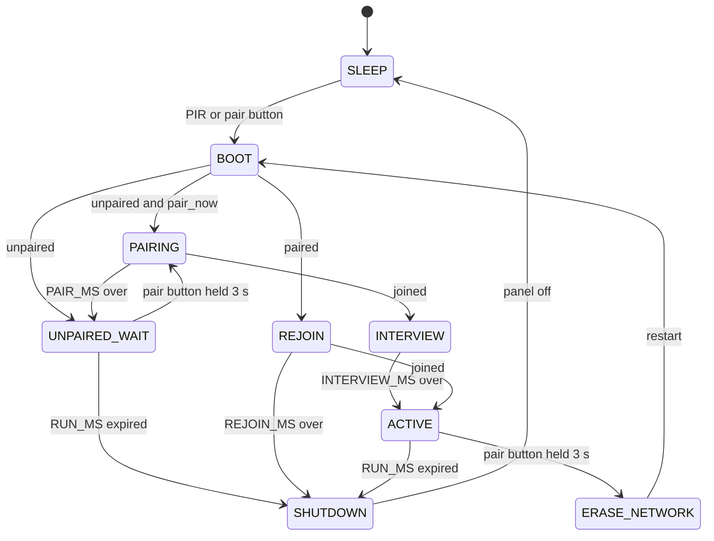

# Greenlight: design (draft for review)

Status: draft, 2026-10-12 (rev 4). Implemented and tested on the hardware: the e-paper driver, the pin
move, and plan step 1 (inputs, state machine, simulated sleep; Zigbee stubbed, see 3.5 and 12).

## 1. Goal

A battery-powered Zigbee device with a 4.2" 400x300 e-paper panel that shows Home Assistant's list of
"problems" (doors and windows left open, lights left on, ...). Each line is a text (an icon later), e.g.
`Living room door open`. An empty list shows a full-screen "All OK" graphic instead. A small footer shows
when the screen was last confirmed up to date.

The device sleeps (deep sleep) whenever nobody is around and is alive and live-updating while someone is
looking at it. The PIR sensor and the pair button are the only things that wake it, and the PIR (or the button) keeps it awake. Pairing to a Zigbee network
comes first: an unpaired device does nothing useful until it is paired.

## 2. Overview

```
  HA (template sensor: lines + hash)       Zigbee2MQTT (external converter)           device
  ──────────────────────────────────       ────────────────────────────────           ──────
  current_hash ─┐                                                                      PIR on -> wake
                │   awake / shown_hash  <── attribute reports <───────────────────────  rejoin, report
  automation:   │                                                                      ...
  awake && shown_hash != current_hash ─►  /set {hash, lines[], footer} ─► frames ────► buffer, redraw
                                                                                        report shown_hash
                                                                                       PIR off + timeout
                                         awake=false  <──────────────────────────────  report, deep sleep
```

Principles:

- **Push from HA, state from the device.** The device never asks for data. It exposes `awake` and
  `shown_hash`; HA pushes whenever the device is awake and stale.
- **Snapshots, not deltas.** Every push is the complete list, so a lost, repeated or late frame never
  leaves lasting damage, and a device that slept through any number of changes catches up in one push.
- **The panel is the memory.** The e-paper keeps its image without power (but see the MVP full clear in
  3.4).
- **The device is dumb.** HA writes the final text; the device only lays out lines.

## 3. Device behaviour

### 3.1 Inputs

| Input | Pin | Meaning |
|---|---|---|
| PIR | D0 (GPIO0) | "somebody is around". The button on D0 simulates it: pressed = PIR active. Active-low button vs. active-high PIR: polarity behind one macro. A deep-sleep wake pin (GPIO0-7). |
| Pair button | D1 (GPIO1), see 10 | also a deep-sleep wake source. Active-low, internal pull-up. A 3 s hold (`RESET_HOLD_MS`) does the one thing it is for, with no feedback while holding: unpaired, it starts pairing; paired, it clears the network and starts pairing. Short presses only wake the device. |

"Activity" below means: PIR active **or** pair button pressed. Either one wakes the device from sleep, and
either one holds the `RUN_MS` timeout. The 3 s hold is measured from when the button went down; a button
still held from the wake-up counts from boot. So one continuous 3 s hold from sleep is enough, both to
start pairing (unpaired) and to reset the network (paired).

### 3.2 Timeouts

| Name | Value | Meaning |
|---|---|---|
| `RUN_MS` | 5 s | activity timeout. Held at full while the PIR is active or the pair button is pressed, counts down after it is released, re-armed by any new activation. At 0 the device shuts down. |
| `PAIR_MS` | 180 s | length of the pairing window. |
| `INTERVIEW_MS` | 60 s | time to stay awake after joining, for the Z2M interview. |
| `RESET_HOLD_MS` | 3 s | pair button hold: start pairing (unpaired) or clear the network and start pairing (paired). |
| `REJOIN_MS` | 15 s | give up a rejoin after this long (MVP budget assumption is 3 s, see 3.6). |

### 3.3 State machine

Pairing comes before PIR-driven behaviour. At every boot or wake the device first asks "am I paired?".
Only a paired device runs the PIR-driven part. An unpaired device only waits for the pair button; activity
(PIR or button) just keeps it awake while it waits. Pairing starts on a 3 s hold, same as the network reset.



(Mermaid: renders on GitHub and in VS Code with a Mermaid preview extension. The table below says the same
thing in text.)

States and transitions:

| State | What it does | Leaves when |
|---|---|---|
| **SLEEP** | nothing runs | PIR active or pair button pressed -> BOOT |
| **BOOT** | init, read the stored snapshot and `shown_hash` from retained memory (empty after a cold boot: `shown_hash = 0`), check the stack for a stored network | paired -> REJOIN; unpaired and `pair_now` flag set -> PAIRING (flag cleared); unpaired -> UNPAIRED_WAIT |
| **UNPAIRED_WAIT** | shows the "press the pair button" screen; `RUN_MS` runs as usual (activity keeps it awake, so the hold can complete) | pair button held `RESET_HOLD_MS` -> PAIRING; `RUN_MS` expired -> SHUTDOWN |
| **PAIRING** | network steering; ignores the PIR; shows the pairing screen | joined -> INTERVIEW; `PAIR_MS` over -> "Pairing failed" screen, back to UNPAIRED_WAIT |
| **INTERVIEW** | awake and answering Z2M; ignores the PIR; reports `awake` and `shown_hash` so HA can already push | `INTERVIEW_MS` over -> ACTIVE |
| **REJOIN** | restores the network from NVS and rejoins; the stored snapshot is on screen | joined -> ACTIVE; `REJOIN_MS` expired -> SHUTDOWN |
| **ACTIVE** | listens continuously, receives pushes, redraws, reports; heartbeat every 30 s; `RUN_MS` as in 3.2 | `RUN_MS` expired -> SHUTDOWN; pair button held `RESET_HOLD_MS` -> ERASE_NETWORK |
| **ERASE_NETWORK** | polite leave, erase the Zigbee storage, clear the stored snapshot and `shown_hash`, set the `pair_now` flag, restart | restart -> BOOT (-> PAIRING) |
| **SHUTDOWN** | finish any refresh, final clean refresh (clear, then render the current snapshot), report `awake = false` (best effort), `epd_poweroff()` | -> SLEEP; if an input is already active, the next wake is immediate |

Rules that keep it simple:

- One timer per state, no hidden state elsewhere. The only things that survive SLEEP are the retained
  data (stored snapshot, footer, `shown_hash`, `pair_now`) and the Zigbee network in NVS.
- The pair button is only acted on in UNPAIRED_WAIT and ACTIVE, both times as a 3 s hold. In every other state it is ignored, apart from waking the device.
- A failed pairing never erases anything; the device stays factory new.
- A failed rejoin never erases the network; only the pair button does.

### 3.4 MVP panel handling (full clear, optimize later)

On every wake (BOOT), the panel gets a full clear (so the controller has a valid previous frame for
partial updates, see CLAUDE.md), then the stored snapshot and stored footer are rendered right away, in
parallel with the rejoin. When HA pushes a changed snapshot or a fresh footer, the screen is partially
refreshed once more. Consequence: the screen flashes once per wake. The stored snapshot (lines + footer,
well under 1 KB) lives in retained RAM, since the 15 KB framebuffer does not fit. Optimizations for later:

- O1: do not touch the panel on wake if nothing changed (clear lazily, only when a redraw is needed).
- O2: skip the final clean refresh at SHUTDOWN when no partial update happened since the last one.
- O3: persist the snapshot in NVS so it survives a battery change.

### 3.5 Current code (plan step 1 done)

`main/hello_world_main.c` implements the state machine of 3.3 and the timeouts of 3.2:

- inputs (D0, D1) are polled and debounced by a task, level based; `RUN_MS` = 5 s;
- all states exist; Zigbee is stubbed (join succeeds after 3 s, rejoin after 1 s, the pairing-window-over
  path is therefore not exercised); ERASE_NETWORK only clears the NVS flags;
- `paired` and `pair_now` are in NVS; SLEEP is the simulation of 3.6;
- each state shows a placeholder word (WAIT, PAIR, FAIL, INTERVIEW, REJOIN, ERASE); ACTIVE still runs the
  ONE..TEN refresh test instead of the real content;
- `INTERVIEW_MS` is **10 s for development** (design value 60 s): set it back before real use.

Tested on the board: unpaired start (no press: shutdown, still unpaired; press: pairing), 3 s hold erase and
re-pair, wake by PIR and by pair button, hold keeps awake, re-arm during the countdown, 2 s hold does not
erase. A factory-new device: erase the NVS partition (command in CLAUDE.md).

### 3.6 MVP sleep simulation and rejoin budget

Deep sleep is the last step. Until then a top-level loop simulates it:

```
app_main():  BOOT -> ... -> SHUTDOWN -> sleep_wait_for_wake() -> esp_restart()
```

- `sleep_wait_for_wake()` blocks until the PIR input (D0) or the pair button is active. In the final
  firmware it is replaced by `esp_deep_sleep_start()` with both pins as wake sources (the wake-up status
  register tells which one fired, though BOOT only needs the pin levels); nothing else changes.
- `esp_restart()` makes the next cycle run the complete real boot path: stack init, restore from NVS, rejoin.
  Only retained RAM and NVS carry over, as after a real deep-sleep wake. It is not known whether
  retained RAM (`RTC_DATA_ATTR`) survives a software restart on the C6; the MVP assumes it does not and
  keeps those few fields (stored snapshot, footer, `shown_hash`, `pair_now`) in NVS. At the final deep-sleep
  step they can move to retained RAM to save flash writes.
- The radio stays powered during the simulated sleep, so the power numbers mean nothing yet; the
  functional behaviour (cold stack start, rejoin, resync via `shown_hash`) is the same.

**Rejoin time.** A web search found no measured wake-to-rejoin number for the ESP32-C6 with the
esp-zigbee-sdk, and some reports of lengthy commissioning after leaving deep sleep. MVP budget: assume 3 s
(range 1-3 s) in the latency table and treat `REJOIN_MS` = 15 s as the hard limit. The real number is the
first thing to measure when Zigbee runs: log the time from boot to the "joined" signal over many wakes.

## 4. Pairing details

- **Detecting "no network"**: the esp-zigbee-sdk signal `ESP_ZB_BDB_SIGNAL_DEVICE_FIRST_START` means
  factory new, `..._DEVICE_REBOOT` means a network was restored from NVS. (BOOT uses it; this is why
  BOOT cannot finish before the stack has reported.)
- **PAIRING** runs BDB network steering with retries for `PAIR_MS`. The user enables "Permit join" in
  Zigbee2MQTT meanwhile. Panel: static "Pairing..." screen.
- **INTERVIEW**: Z2M reads Basic cluster attributes and so on (several seconds, sometimes tens). The Basic
  cluster must report a fixed manufacturer name and model id so the external converter can match the
  device. HA can already push the first snapshot (`shown_hash = 0` differs from `current_hash`).
- **ERASE_NETWORK**: a polite leave (`esp_zb_bdb_reset_via_local_action()` in the SDK), then erase the
  Zigbee storage (`esp_zb_factory_reset()`, which restarts the chip), after setting `pair_now` so the next
  BOOT goes straight to PAIRING. The SDK function names are from memory; verify when implementing.
- **Z2M side**: after a reset, Z2M may still list the old device. A re-pair with the same IEEE address
  works as a rejoin; to start clean, remove the device in Z2M first.
- The reset is done with the device awake; the pair button itself wakes it, so one continuous 3 s hold from sleep is enough.

## 5. Data model

### 5.1 Snapshot (HA side, logical)

```json
{ "hash": 48213,
  "lines": [ {"icon": "door",   "text": "Living room door"},
             {"icon": "window", "text": "Kitchen window"} ],
  "footer": "Updated 14:32" }
```

- `hash`: 32-bit value chosen by HA, identifying the content of `lines` (e.g. CRC32 of icon+text of every
  line). The device stores and echoes it; it never computes it. The same lines always give the same hash.
  The footer is **not** part of the hash (it changes every minute and must not cause a push by itself).
- `lines`: **at most 6**, already sorted and truncated by HA; if the list is longer, the sixth is
  "+N more". Text is plain ASCII for the MVP (no accents), about 21 characters at most (see 8).
- Empty `lines` means "All OK".
- `icon`: kept in the format as a 1-byte number for later, **ignored by the MVP** (the device draws
  text only).
- `footer`: a short text (about 30 bytes), written by HA.

### 5.2 Staleness footer

The screen is only as fresh as the last wake. The footer is the fix: HA sends a footer with the current
time **every time the device reports `awake = true`** and with every content push. Its meaning is "the last
time this screen was confirmed in sync with HA". If the time is old, the viewer knows the data may be old.

- The footer is a separate frame (`SetFooter`), not tied to a hash change.
- The device stores the footer text with the snapshot and redraws it with the next refresh. Footer and
  lines that arrive close together are coalesced into one refresh (debounce about 300 ms).
- The footer sits in a reserved strip at the bottom of the screen (about 20 px), also on "All OK".

### 5.3 State exposed by the device

| Name | Meaning | When reported |
|---|---|---|
| `awake` (bool) | joined and listening, can receive pushes | after (re)join and in INTERVIEW; every 30 s while awake; `false` in SHUTDOWN |
| `shown_hash` (u32) | hash of the snapshot currently on the panel | after (re)join; after every redraw; every 30 s while awake |

`shown_hash` after a redraw is the acknowledgement of a push.

## 6. Zigbee transport

A manufacturer-specific cluster (0xFC00 range, exact id TBD) on the ESP32-C6 with esp-zigbee-sdk, as an
end device (rx-on-when-idle while awake).

- Attributes: `awake` (bool), `shown_hash` (u32), reportable.
- Command `SetLines` (to the device), one frame carrying as many lines as fit (about 50-60 bytes of
  payload per frame; 6 lines of 21 characters need about 3 frames):

  ```
  hash: u32 | total: u8 | first: u8 | count: u8 | count x { icon: u8 | len: u8 | ascii[len] }
  ```

- Command `SetFooter` (to the device): `len: u8 | ascii[len]`.
- Disable default responses on both commands.

Device handling of a `SetLines` frame:

1. `hash == shown_hash` -> ignore (re-report `shown_hash`).
2. `hash` differs from the buffered hash -> drop the partial buffer, start a new one.
3. Store the lines at `first..first+count-1`. When `total` lines are present, render and report
   `shown_hash`. `total == 0` is "All OK" (a frame with `count = 0`).
4. A partial buffer is simply dropped at SHUTDOWN; HA's retry fixes it.

## 7. Home Assistant / Zigbee2MQTT

- **Z2M external converter**: `fromZigbee` for the two attributes (exposes `awake`, `shown_hash`);
  `toZigbee` that turns the JSON snapshot into `SetLines` and `SetFooter` frames. Disable Z2M availability
  for this device (for battery devices it only trips after hours, so it says nothing useful).
- **HA template sensor**: builds the sorted, truncated `lines` (max 6) and `current_hash`.
- **HA automation**, triggered by any change of `awake`, `shown_hash` or `current_hash`:
  - on `awake` becoming true: send the footer (current time); if `shown_hash != current_hash`, also the
    snapshot
  - while `awake` is true and `shown_hash != current_hash`: publish the snapshot (with footer) to
    `zigbee2mqtt/<device>/set`; wait about 5 s; if `shown_hash` still differs, resend (a few retries at
    most)
  - debounce a few seconds after `current_hash` changes, so a burst of events gives one refresh.
- `awake` is considered true only if the last report is younger than about 90 s (covers a device that
  died without saying goodbye).

## 8. Display (MVP)

- 400x300, 1 bit. Current partial refresh ~470 ms; see CLAUDE.md for panel quirks (ghosting, grain).
- ASCII only, no accents, no icons in the MVP. The existing 5x7 font (only the test glyphs) is extended
  to printable ASCII. At scale 3 a character is 18 px advance x 21 px high: about 21 characters per line
  across 384 px.
- 6 rows of about 46 px (text vertically centered or top-aligned in the row) plus a footer strip of about
  20 px at the bottom, smaller font (scale 2).
- Static screens as full-screen drawings: "All OK", "Press the pair button", "Pairing...", "Pairing
  failed". For the MVP these can be drawn with the same text routine.
- Later: Hungarian accents (Latin Extended-A font from a TTF at build time) and icons (1-bit bitmaps
  indexed by the wire icon number, about 24x24, text shifted right).

## 9. Failure modes

| Situation | Behaviour |
|---|---|
| Frame lost | HA resends after 5 s; the device ignores repeats of the hash it already shows. |
| Device sleeps mid-update | Partial buffer dropped; next wake reports the old `shown_hash`, HA pushes again. |
| HA down / Zigbee down | Screen keeps the stored snapshot; its footer time stops advancing, so the staleness shows. |
| Rejoin fails (parent gone) | After `REJOIN_MS` the device shuts down with the stored snapshot on screen; network kept. |
| Parent forgot the device | Slower full rejoin on wake. Set the end-device timeout as long as the stack allows. |
| Device dies silently | `awake` expires in HA after about 90 s. |
| Pairing fails | "Pairing failed" screen, UNPAIRED_WAIT; still factory new. |
| Frame counter | Must persist across deep sleep or the parent rejects the device. The SDK persists it; verify. |
| Cold boot (battery change) | Retained RAM empty: blank snapshot, `shown_hash = 0`, HA pushes on join. |

## 10. Pins

Both wake inputs must be deep-sleep wake pins, which on the ESP32-C6 are GPIO0-7 (on the XIAO header: D0,
D1, D2). The panel's DC and RST lines were moved off D1/D2 for that reason (done).

| Pin | Use |
|---|---|
| D0 (GPIO0) | button now (simulates the PIR), PIR output later; wake pin |
| D1 (GPIO1) | **pair button** (`PAIR_BUTTON_PIN`), to GND, internal pull-up; wake pin |
| D2 (GPIO2) | free (spare wake pin) |
| D3 (GPIO21) | panel BUSY |
| D4 (GPIO22) | panel DC |
| D5 (GPIO23) | panel RST |
| D8, D9, D10 | panel SCK, CS, MOSI |

The panel pins are held low before power-off (existing code); that works on any GPIO. Avoid D6/D7 (UART0)
in case the console moves there. Because the pair button is already on its final wake pin, the MVP uses
D1 as well (earlier drafts said D4).

## 11. Decisions so far and open questions

Decided: `RUN_MS` 5 s; `PAIR_MS` 180 s; `INTERVIEW_MS` 60 s; 3 s hold, no feedback; MVP full clear; no
accents and no icons; 6 lines; PIR's own hold time is ignored; deep sleep simulated by a top-level loop;
PIR and pair button both wake the device; the pair button is on D1 (panel DC/RST moved to D4/D5, done);
retained RAM assumed not to survive a software restart (NVS in the MVP).

Open:

- **Q1** Real rejoin time (measure once Zigbee runs).
- **Q2** Retained RAM across deep sleep is fine on the C6; across `esp_restart()` it is unverified. Only
  matters for flash wear, not for correctness.

## 12. Implementation plan

1. **Done.** Level-based PIR/button timeout with `RUN_MS` = 5 s, polarity macros, state machine with Zigbee
   stubbed, pair button on D1, simulated sleep with NVS.
2. **Next: renderer.** Full-ASCII font (replace the 5x7 test glyphs), 6 rows plus footer strip, static
   screens (All OK, press the pair button, pairing, pairing failed) replacing the placeholder words, a test
   list on the panel in ACTIVE instead of the ONE..TEN test (event-driven redraw), stored snapshot and
   footer kept across sleep (NVS) and redrawn after the MVP full clear in BOOT.
3. Zigbee: custom cluster, attributes, `SetLines`/`SetFooter` handlers, pairing, interview, rejoin,
   rx-on-when-idle while awake, ERASE_NETWORK (real leave and erase). Make the stub failures testable first
   (pairing window over, rejoin failed). Set `INTERVIEW_MS` back to 60 s. Measure the rejoin time.
4. Z2M external converter and HA automation; measure end-to-end latency.
5. Proper deep sleep: wake on D0 and D1 (replace `st_sleep`), move the retained state to retained RAM. Then
   the optimizations O1-O3, accents and icons.
