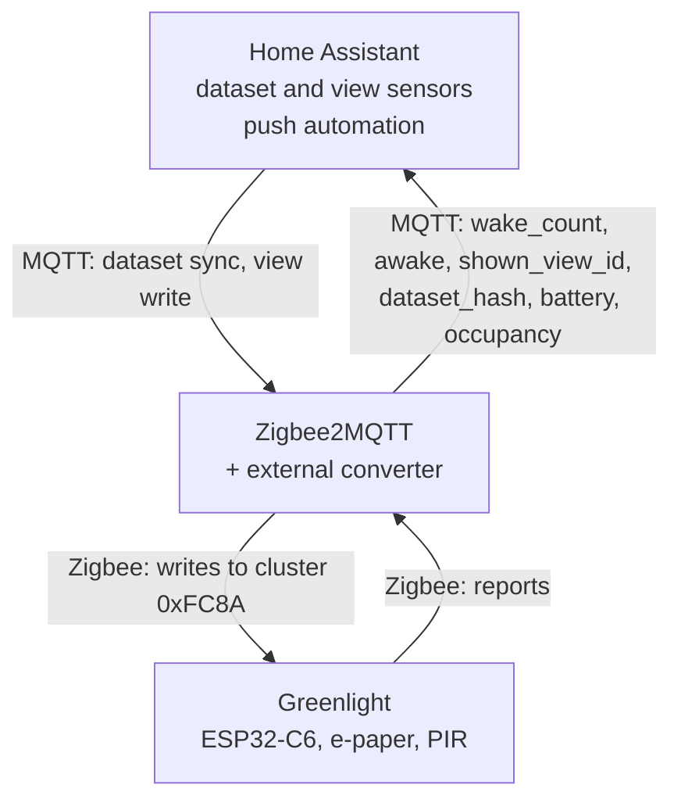
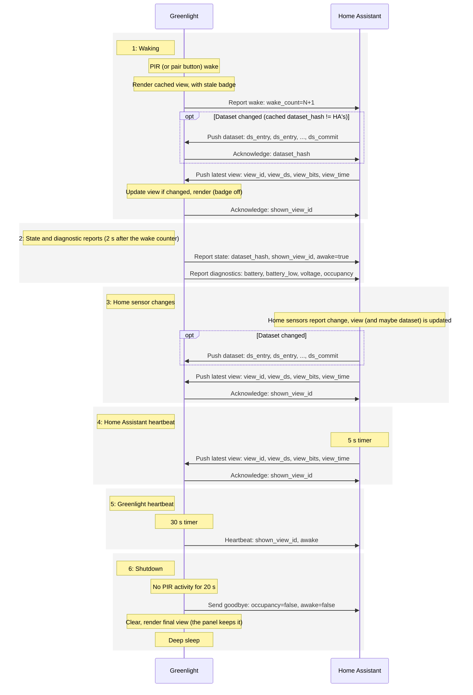

# Architecture

## Purpose

A battery-powered device that shows Home Assistant's list of "problems" (doors and windows left open, lights left
on, ...). Each line has an icon, a name and a state, such as `Patio door | open`. An empty list shows a large
*All OK* checkmark instead. A badge in the corner shows when the screen is no longer confirmed up to date.

## Design goals

- Functional: show the list of problems with icon, name and state, or *All OK*, readable at a glance
  ([UI spec](uispec/ui-spec.md#principles))
- Responsiveness: the list updates in real time, with a delay under 1 s
- Battery: at most one battery charge per year
- Reliability: appliance-like, zero-maintenance operation: automatic recovery from the usual errors (network or
  Home Assistant outage, power loss, restarts). Software bugs and hardware failures stay visible instead of being
  masked.

**Success metrics**

- Time from device wake to first render of live data
- Time from changed Home Assistant data to render of live data
- Count of maintenance sessions (reset, re-pair, etc. - any touch of the device)
- Time between battery charges

## Design constraints

- Zigbee frames carry a limited amount of data. No frame relies on a good position in the mesh: every frame must
  fit the worst-case path (40 bytes of ZCL payload, [zigbee.md](zigbee.md#frame-size-and-polling)).
- Frames to and from the sleepy device get lost, most often right after a wake (measured: 5-7 % per frame), and
  each loss delays the exchange by about 13 seconds while Zigbee2MQTT recovers. Time-critical data goes first.
  Writes are paced, never burst, so the parent router's small queue for sleepy devices never overflows.

## System overview

Greenlight is a sleepy Zigbee end device that spends most of its life in deep sleep. A low-power PIR sensor wakes
it when someone steps in front of it. It then rejoins the network and gets the latest state from Home Assistant.
It stays live while someone is there and goes back to sleep afterwards. This shapes almost all aspects of the
architecture and software design.

**Data is pushed from Home Assistant.** A Home Assistant automation ([`ha/`](../ha/)) observes when Greenlight is
awake and pushes data. The device never asks for data; it only reports what it shows.

**The device is dumb.** Home Assistant creates the data lines, orders them as they should appear on the screen
(dataset), and decides which lines of the dataset are active (view). The device only lays the view lines out.
The dataset and the view are both identified by a hash, so the system can detect when updates are needed.
The hashes are computed exclusively in the Home Assistant automation. The device never computes a hash; it only stores
the ones it receives and echoes them back.

The pieces: the firmware ([firmware.md](firmware.md)), the Zigbee interface ([zigbee.md](zigbee.md)), the
Zigbee2MQTT converter in [`z2m/`](../z2m/) and the Home Assistant templates and automation in [`ha/`](../ha/)
([home-assistant.md](home-assistant.md)).

## Data model

Data is split into two parts to minimize data transfer. Lost frames are the biggest cause of delays, so the "happy
path" uses the minimum number of frames: each wake is one frame up (the wake counter) and one frame down (the
view). Details: [data-model.md](data-model.md).

**Dataset**

The dataset consists of all possible lines the device can display (icon, name, state), in the order they should
appear on the screen. This is a large amount of relatively stable data: it only changes when entities are added,
removed or renamed in Home Assistant. A dataset sync transfers the entire dataset, where each line is up to 3
frames, and takes from a few seconds to over a minute. During day-to-day operation, Greenlight uses its cached
copy of the dataset, identified by a hash.

**View**

The view is a bitfield of active lines from the (cached) dataset. This is frequently changing but small data (it
fits in a single Zigbee frame). Despite the minimal size, it carries the full view atomically. Every view push is
the complete bitfield, so a lost, repeated or late frame never leaves lasting damage, and a device that slept
through any number of changes catches up in one push.

**Dataset and view out of sync**

Dataset and view arrive separately and in no fixed order: a view can arrive before its dataset, e.g. after a sync
cut short by sleep or a lost commit. The view is tied to its dataset by the dataset's hash. A view for another
dataset is rejected: the device keeps its stored view, shows the *Synchronizing* screen while awake, reports its
own dataset hash and stays awake for the sync. Likewise, a new dataset alone never changes the screen.

The mismatch fixes itself: every Home Assistant push syncs the dataset first if the hashes differ, then sends the
view, so the next push (within 5 s while awake) repairs it. A lost or misordered frame costs a resend, never a
wrong screen.

## Wake window

At the start of the wake window, the data exchange follows a strict priority order. Every frame risks a loss and a
long delay, so critical data is exchanged first. The device reports only its wake counter, and Home Assistant
answers with the view. During day-to-day operation the dataset is already cached; if it has changed, Home Assistant
syncs it before the view, since the view refers to it. This initial exchange is the most time-critical part; and
unfortunately, this is when most frame losses are observed to happen. To mitigate the risk and give the best chance
of achieving a low wake-to-render time, the first 2 seconds of the wake window are reserved for the initial
exchange, to free up resources in the Zigbee network.

About 2 seconds after the wake counter, when the view has normally arrived, the device reports the rest of its
state and diagnostics. While the device is awake, the Home Assistant automation pushes new datasets and new views
as needed.

At the end of the wake window, the device sends goodbye messages (awake=false, occupancy=false), then clears the
panel and renders the current view one last time. The panel is the memory: the e-paper keeps its image without
power, so the screen keeps showing the last view while the device is in deep sleep. If the wake ended without fresh
data, the stale badge stays on until the next wake.

Both sides send heartbeats to the other to observe liveness:

- Home Assistant sends a heartbeat every 5 seconds (the view, even if unchanged). Greenlight uses it to maintain
  the staleness indicator.
- Greenlight sends a heartbeat (shown_view_id and awake) every 30 seconds. Home Assistant uses it to detect a lost
  goodbye.

