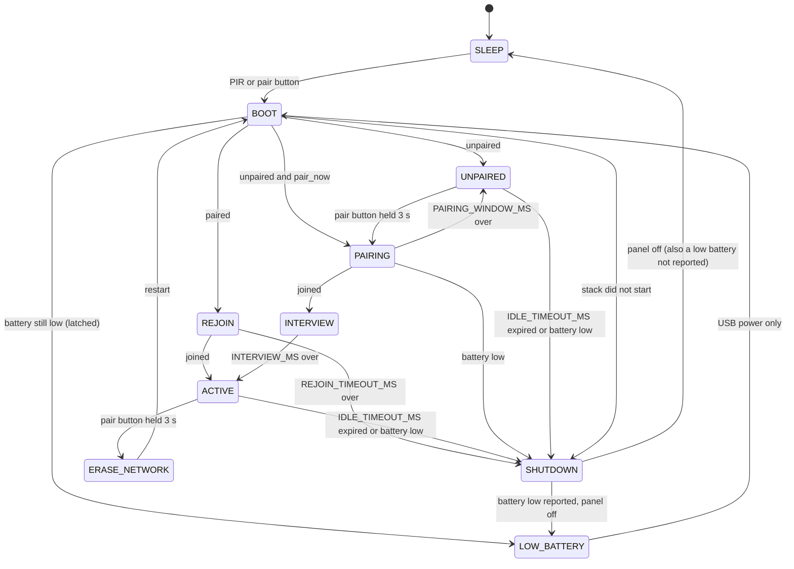

# Device behaviour

How the device reacts to its inputs: states, timeouts, sleep, pairing, low battery and failures. The code is
`main/state_machine.c` (states, timeouts) with `main/board/` (inputs, sleep, battery).

## Inputs

| Input | Pin | Meaning |
|---|---|---|
| PIR | D0 (GPIO0) | "somebody is around". Active high. A deep-sleep wake pin. Wiring in [hardware.md](hardware.md#pins). |
| Pair button | D1 (GPIO1) | Active low, internal pull-up; also a deep-sleep wake pin. A 3 s hold (`PAIR_BUTTON_HOLD_MS`) does the one thing it is for, with no feedback while holding: unpaired, it starts pairing; paired, it clears the network and starts pairing. Short presses only wake the device. |

Both inputs are polled and debounced by `input_task` (level based). "Activity" below means: PIR active **or**
pair button pressed. Either one wakes the device from sleep, and either one holds the `IDLE_TIMEOUT_MS`
timeout. HA's writes are not activity: they keep the device awake for a time of their own (`DATASET_SYNC_HOLD_MS`,
`RESYNC_HOLD_MS`). The wake ends once there has been no activity for `IDLE_TIMEOUT_MS` and no such hold is left. The 3 s hold is measured from when the button went down; a button still held from the wake-up counts
from boot. So one continuous 3 s hold from sleep is enough, both to start pairing (unpaired) and to reset the
network (paired). The PIR's own hold time is ignored.

## Timeouts

| Name | Value | Meaning |
|---|---|---|
| `IDLE_TIMEOUT_MS` | 20 s | activity timeout. Held at full while the PIR is active or the pair button is pressed, counts down after release, re-armed by any new activation. At 0, with no hold left, the device shuts down. UNPAIRED and ACTIVE also hold the wake this long when they begin. Long enough to see a push arrive after a wake. |
| `DATASET_SYNC_HOLD_MS` | 20 s | each `ds_entry` and `ds_commit` keeps the device awake this long, for the next part or the view after the commit ([zigbee.md](zigbee.md#dataset-sync)). |
| `RESYNC_HOLD_MS` | 20 s | an out-of-sync view keeps the device awake this long, for HA to see `dataset_hash` and start the sync ([zigbee.md](zigbee.md#view-push)). |
| `PAIRING_WINDOW_MS` | 180 s | length of the pairing window. |
| `INTERVIEW_MS` | 60 s | time to stay awake after joining, for the Z2M interview. |
| `PAIR_BUTTON_HOLD_MS` | 3 s | pair button hold: start pairing (unpaired) or clear the network and start pairing (paired). |
| `STACK_START_TIMEOUT_MS` | 30 s | BOOT waits this long for the Zigbee stack to report whether it restored a network ([Pairing](#pairing)). |
| `REJOIN_TIMEOUT_MS` | 15 s | give up a rejoin after this long (a rejoin normally takes about 1.5 s). |
| `VIEW_WAIT_MS` | 45 s | ACTIVE does not shut down before this long (from entering ACTIVE) while no view has been applied in this wake, so a write that Z2M lost can still arrive as HA's resend ([home-assistant.md](home-assistant.md#push-automation)). Covers HA's 20 s acknowledgement timeout plus one more 13 s Z2M recovery. Costs battery only in wakes without a view (HA or Zigbee down). |
| `HEARTBEAT_MS` | 30 s | ACTIVE repeats `awake` + `shown_view_id` this often. |
| `WAKE_REPORTS_DELAY_MS` | 2 s | after a rejoin, the reports that follow the wake counter ([zigbee.md](zigbee.md#when-the-device-reports)). |
| `OCCUPANCY_HOLD_MS` | 5 s | reported occupancy: the PIR was active within this long. A PIR wake counts as PIR activity at boot, so the wake's short pulse, long over when the wake's reports go out (about 3.5 s after boot after a fast rejoin), is still reported. After a slow rejoin it may be lost. |
| `GOODBYE_TIMEOUT_MS` | 5 s | SHUTDOWN waits up to this long for Z2M to confirm `occupancy` = 0 and `awake` = false. |
| `VIEW_VALID_MS` | 8 s | a received view is fresh this long ([data-model.md](data-model.md#staleness-flag)): HA's 5 s push period while awake plus 3 s for the push to arrive (normally 0.1-1.3 s). |
| `BATTERY_CHECK_MS` | 1 s | mid-wake battery check period ([Low battery](#low-battery)). |
| `BATTERY_REPORT_TIMEOUT_MS` | 10 s | SHUTDOWN resends the low-battery report up to this long until Z2M confirms it ([Low battery](#low-battery)). |

## State machine

Pairing comes before PIR-driven behaviour. At every boot or wake the device first asks "am I paired?".
Only a paired device runs the PIR-driven part. An unpaired device only waits for the pair button; activity
(PIR or button) just keeps it awake while it waits.

The same in text (the screen each state shows is in [display.md](display.md#device-screens)):

| State | What it does | Leaves when |
|---|---|---|
| **SLEEP** | deep sleep, nothing runs | PIR active or pair button pressed -> BOOT |
| **BOOT** | first the battery check, before the radio and the panel; then init, read the stored dataset and view from NVS (none after an erase: `dataset_hash = 0`, `shown_view_id = 0`), check the stack for a stored network | battery low and latched -> LOW_BATTERY (panel untouched); battery low, not latched: boot on, so ACTIVE reports it ([Low battery](#low-battery)); stack not started within `STACK_START_TIMEOUT_MS` -> SHUTDOWN (*Unknown error* screen); paired -> REJOIN; unpaired and `pair_now` flag set -> PAIRING (flag cleared); unpaired -> UNPAIRED |
| **UNPAIRED** | shows the *Pairing* screen (how to pair); `IDLE_TIMEOUT_MS` runs as usual (activity keeps it awake, so the hold can complete) | pair button held `PAIR_BUTTON_HOLD_MS` -> PAIRING; `IDLE_TIMEOUT_MS` expired, no hold left -> SHUTDOWN; battery low -> SHUTDOWN |
| **PAIRING** | network steering; ignores the PIR | joined -> INTERVIEW; `PAIRING_WINDOW_MS` over -> UNPAIRED; battery low -> SHUTDOWN |
| **INTERVIEW** | awake and answering Z2M; ignores the PIR; reports the wake state so HA can already sync the dataset and push the view | `INTERVIEW_MS` over -> ACTIVE |
| **REJOIN** | restores the network from NVS and rejoins; the stored view is on screen | joined -> ACTIVE; `REJOIN_TIMEOUT_MS` expired -> SHUTDOWN |
| **ACTIVE** | listens continuously, receives pushes, redraws, reports; heartbeat every `HEARTBEAT_MS` | `IDLE_TIMEOUT_MS` expired, no hold left (and `VIEW_WAIT_MS` passed or a view arrived) -> SHUTDOWN; pair button held `PAIR_BUTTON_HOLD_MS` -> ERASE_NETWORK; battery low -> SHUTDOWN |
| **ERASE_NETWORK** | set the `pair_now` flag, clear the stored dataset and view, polite leave, erase the Zigbee storage, restart | restart -> BOOT (-> PAIRING) |
| **SHUTDOWN** | if joined, report `occupancy` = 0 and `awake` = false and wait for Z2M to confirm them (up to `GOODBYE_TIMEOUT_MS`; a failed rejoin, an unpaired device or a stack that did not start sends nothing); then the final clean refresh (clear, then render the current view); `epaper_power_off()` | -> SLEEP; if an input is already active, the next wake is immediate. After a low battery: report the battery (`battery_low`) before the goodbye until Z2M confirms it (up to `BATTERY_REPORT_TIMEOUT_MS`), draw the *Battery dead* screen; confirmed: latch `bat_low`, -> LOW_BATTERY; not confirmed (or not joined): -> SLEEP, the next wake tries again |
| **LOW_BATTERY** | the *Battery dead* screen is on the panel, the radio is off; the PIR and the pair button are ignored | USB power -> BOOT (restart) |

Rules that keep it simple:

- One timer per state, no hidden state elsewhere. The only things that survive SLEEP are the retained
  data in NVS (stored dataset and view, `pair_now`, the wake counter, the battery latch), the staleness
  deadline in RTC memory and the Zigbee network in NVS ([firmware.md](firmware.md#persistent-state)).
- The pair button is only acted on in UNPAIRED and ACTIVE, both times as a 3 s hold. In every other state it
  is ignored, apart from waking the device.
- A failed pairing never erases anything; the device stays factory new.
- A failed rejoin never erases the network; only the pair button does.

## Panel on each wake

On every wake (BOOT) the panel gets a full clear (so the controller has a valid previous frame for partial
updates, [hardware.md](hardware.md#e-paper-panel)), then the stored view is rendered right away, in parallel
with the rejoin. The stored view is normally stale by then, so it carries the stale badge; HA's wake push
removes it with one partial refresh. So the screen flashes once per wake. SHUTDOWN ends with a clear and a
final render of the current view. Between those, every redraw is a partial refresh
([display.md](display.md#refresh-policy)).

## Deep sleep

SLEEP is `esp_deep_sleep_start()` (`sleep_until_input()` in `main/board/sleep.c`), on USB power as well as on
the battery:

- Wake sources: ext1 with a level per pin, D0 (PIR) on high, D1 (pair button) on low. Level, not edge: an
  input still active when the device goes to sleep wakes it at once, as SHUTDOWN expects. The internal pulls
  do not carry into deep sleep, so `sleep_until_input()` sets them again on the LP IO side (D1 pull-up, D0
  none; the sleep code holds them), and `inputs_init()` releases that hold at boot.
- The wake is a reset: the complete boot path runs (stack init, restore from NVS, rejoin). NVS and RTC memory
  carry over.
- The panel pins stay low and held through deep sleep (`epaper_power_off()`; the C6 holds digital pads in deep
  sleep); `epaper_init()` releases them.
- The wake cause (PIR / pair button / timer / reset) is logged at boot and again on the "stack up" line.
- After a deep-sleep wake no log reaches the PC ([hardware.md](hardware.md#usb-console-and-deep-sleep)); watch
  wakes in HA (`wake_count`, `awake`). For bench work there are build switches for a timer wake and a
  simulated sleep that keeps USB up ([firmware.md](firmware.md#build-switches)).
- The parent ages the device out after `END_DEVICE_TIMEOUT` (64 min) without a poll. A wake after a longer
  sleep still finds the network: the rejoin works (seen 2026-11-05 after 7 h asleep, 00:40 to 07:41).

## Pairing

- **Detecting "no network"**: the stack signal `EZB_BDB_SIGNAL_DEVICE_FIRST_START` means factory new,
  `EZB_BDB_SIGNAL_DEVICE_REBOOT` means a network was restored from NVS. BOOT waits for it, so BOOT cannot
  finish before the stack has reported; after `STACK_START_TIMEOUT_MS` without it, the wake ends with the
  *Unknown error* screen.
- **PAIRING** runs BDB network steering with retries for `PAIRING_WINDOW_MS`. The user enables "Permit join" in
  Zigbee2MQTT meanwhile.
- **INTERVIEW**: Z2M reads the Basic cluster attributes and so on (several seconds, sometimes tens). Z2M stores
  the identity it reads ([zigbee.md](zigbee.md#identity-and-freeze-rules)). HA can already sync the dataset and
  push the first view (`dataset_hash = 0` and `shown_view_id = 0` differ from anything HA has).
- **ERASE_NETWORK** sets `pair_now` and clears the stored dataset and view, then calls
  `zigbee_erase_network()`: a polite leave (`ezb_bdb_reset_via_local_action()`), then
  `esp_zigbee_factory_reset()`, which erases the Zigbee storage and restarts the chip, so the next BOOT goes
  straight to PAIRING.
- **Z2M side**: after a reset, Z2M may still list the old device. A re-pair with the same IEEE address works
  as a rejoin; to start clean, remove the device in Z2M first.

## Low battery

Below `BATTERY_LOW_ENTER_MV` (3.5 V) the wake ends. ACTIVE, UNPAIRED and PAIRING measure and check every
`BATTERY_CHECK_MS` (1 s) and go to SHUTDOWN with the *Battery dead* screen (one final refresh, the farewell
`battery_low` report when joined). INTERVIEW and REJOIN (bounded) and ERASE_NETWORK are not interrupted; a
rejoin that fails on a low battery also ends with the *Battery dead* screen.

**The latch waits for HA.** SHUTDOWN resends the `battery_low` report, asking Z2M for a default response, every
second for up to `BATTERY_REPORT_TIMEOUT_MS` (10 s). Only once Z2M confirms it does SHUTDOWN set the NVS latch
`bat_low` and go to LOW_BATTERY, where the PIR and the pair button no longer wake the device: **only USB power
does**. Unconfirmed, or not joined (failed rejoin, unpaired, stack down), the device shows *Battery dead* but
sleeps as usual, so the next wake finds the battery low at boot and tries again: HA must not be left thinking
the device is fine while it no longer wakes.

- While latched, the exit threshold `BATTERY_LOW_EXIT_MV` (3.7 V) applies. The entry voltage may be read
  under load while the exit check runs at rest, and a nearly empty LiPo recovers tens of mV just by resting,
  so the hysteresis is wide; a charger raises the voltage at once anyway.
- **USB power overrides a low battery** (the device then runs from USB, and a device that slept while already
  on USB would never see a wake edge), so a USB wake clears the latch; unplugging with the cell still low ends
  the next wake the same way.
- **A low battery found at boot is reported.** The cell drains during the sleep, so a wake usually finds it
  already low. Not latched yet, the wake boots on and rejoins, and the first check in ACTIVE ends it with the
  `battery_low` report, so HA learns it; 3.5 V leaves plenty for a few rejoins. Latched, BOOT checks before the
  radio, the panel and any NVS write, and a battery still low goes straight back to LOW_BATTERY.
- LOW_BATTERY is deep sleep with USB sense (GPIO7) as its only wake. How the voltage and USB power are read,
  and the console's overrides for bench tests: [firmware.md](firmware.md#battery-and-usb-power).
- How the battery is reported over Zigbee: [zigbee.md](zigbee.md#battery).

## Failure modes

| Situation | Behaviour |
|---|---|
| Frame lost | HA resends after its acknowledgement timeout; a repeated view with the shown id only makes the screen fresh again, a repeated dataset entry overwrites the staged one. |
| Device sleeps mid-sync | Staged dataset entries dropped; `dataset_hash` unchanged, so HA syncs again at the next wake. A view is one frame and cannot be half applied. |
| View for another dataset | Out of sync ([zigbee.md](zigbee.md#view-push)): screen unchanged (it goes stale), `dataset_hash` reported, device stays awake for the sync. |
| HA down / Zigbee down | Screen keeps the stored view; the stale badge appears at most 8 s after the last view received. |
| Rejoin fails (parent gone) | After `REJOIN_TIMEOUT_MS` the device shuts down with the *Join failed* screen; network kept. |
| Parent forgot the device | Slower full rejoin on wake. |
| Device dies silently | `awake` stays on in HA, but HA stops pushing 90 s after the last report ([awake gate](home-assistant.md#push-automation)). |
| Zigbee stack does not start | After `STACK_START_TIMEOUT_MS` the device shuts down with the *Unknown error* screen. |
| Pairing fails | Back to UNPAIRED with the *Pairing* screen; still factory new. |
| Frame counter | Must persist across deep sleep or the parent rejects the device. The SDK persists it (to verify, [roadmap.md](roadmap.md)). |
| Cold boot (battery change) | Dataset and view are in NVS and survive; the next wake is a normal wake. |
| Battery low | *Battery dead* screen, `battery_low` reported when joined; once Z2M confirms it, LOW_BATTERY until USB power, else the next wake reports again. |
| Wake counter report lost | HA does not push in this wake; the screen keeps the last view, stale. Seen once in 39 wakes. Next wake is normal. |
| Panel BUSY hang | A refresh never finishes and the controller stays stuck until a hardware reset ([hardware.md](hardware.md#busy-hang)). **No recovery, on purpose**, so failures stay visible: each later panel command times out after 10 s (`panel: ... FAILED` in the log), the screen stays grainy grey until the next wake, whose `epaper_init()` resets the panel. Automatic recovery is a later option ([roadmap.md](roadmap.md#future-work)). |
