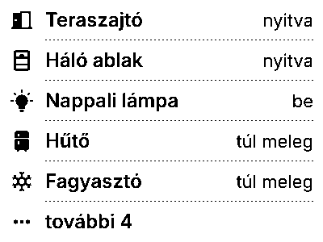
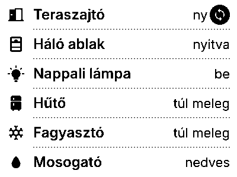
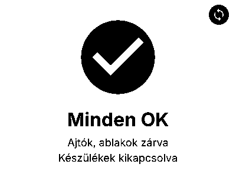
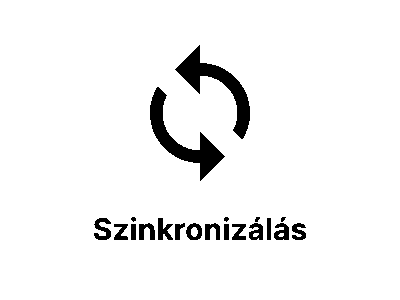
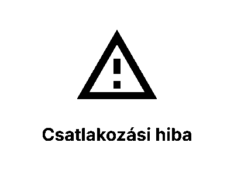
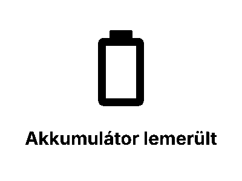

# UI spec

What the screen shows and why. The images in [mockups/](mockups/) are the accepted designs at actual size (400 x
300, 1 bit); the firmware is checked against them pixel for pixel. The layout as built (row heights, font and icon
sizes, cut rules) and when each screen is shown are in [display.md](../display.md).

The texts on the panel are Hungarian. They are quoted as they appear; everything else is in English.

## Principles

**Glanceable.** The display must be understood at a glance from across the room, without glasses and without
knowing the system. Three situations must look different from each other and be impossible to mistake:

| Situation | Look | Screens |
|---|---|---|
| All OK, ready to arm | one large solid black shape in the centre | [All OK](#all-ok) |
| Not ready to arm | a list of rows filling the screen | [Problems](#problems) |
| Device needs attention | one large outline icon and a single word line | [Device screens](#device-screens) |

The staleness indicator must be glanceable too, but not obtrusive.

**Readable.** The problem list uses the whole screen, large legible fonts and short texts.

**Clean.** Show the minimum needed. Nothing goes on the screen just because it could; whatever can be removed
while the screen still does its job is removed. So there is no header, no clock, no battery gauge and no
signal strength on any screen.

**Zero learning curve.** It is an appliance for the family: every screen explains itself.

## House screens

### Problems

Up to 6 problem rows fill the screen from top to bottom: the line icon on the left, the name in bold, the state
right-aligned, dotted separators between rows. With fewer problems the rows start at the top and the rest stays
blank; the rows never spread out or grow.

 

With more than 6 problems, 5 rows are shown and the sixth says "további N" (N more) with the `dots-horizontal`
icon: 9 problems give "további 4".

### All OK

A large solid black `check-circle` in the centre, "Minden OK" below it, then two fixed detail lines ("Ajtók,
ablakok zárva": doors and windows closed; "Készülékek kikapcsolva": appliances off). It is the only large black
shape on any screen, so it reads as "OK to arm" from across the room.

### Stale data

When the shown data is stale ([staleness flag](../data-model.md#staleness-flag)), a small inverted `sync` badge is
drawn over the top-right corner: white arrows on a black disc, with a white ring that separates it from what is
underneath. Its right edge lines up with the end of the states and separators, and it is centred vertically on
the first row's icon. It may cover the end of the first row's state; nothing else moves. With fresh data there is
no badge.

 

## Device screens

A large outline icon, centred, with one line of bold text below. Outline icons keep these screens apart from the
solid check of All OK, and the single centred line keeps them apart from the problem list. The unpaired screen
adds two instruction lines under the title, with a slightly smaller icon, because it is the one screen that asks
the user to act.

| Screen | Situation | Icon | Text |
|---|---|---|---|
| Unpaired | not paired: out of the box, and after a failed pairing attempt | `gesture-tap-hold` | Párosítás / Engedélyezd a csatlakozást / Nyomd a gombot 3 mp-ig (Pairing / Allow joining / Hold the button for 3 s) |
| Searching | Zigbee pairing | `access-point` | Hálózatkeresés (searching for network) |
| Joining | Zigbee interview | `access-point` | Csatlakozás (joining) |
| Syncing | waiting for data from HA | `sync` | Szinkronizálás (syncing) |
| Join failed | a paired device failed to rejoin its network | `alert-outline` | Csatlakozási hiba (connection error) |
| Battery | battery dead | `battery-outline` | Akkumulátor lemerült (battery dead) |
| Error | any other failure | `alert-outline` | Ismeretlen hiba (unknown error) |

A failed pairing attempt goes back to Unpaired, which says what to do; Join failed is only for a paired device.

  
  

## Rules

- **Short texts.** A problem row is a short name and a one- or two-word state ("Hűtő | túl meleg": fridge, too
  warm), no values or details, so every row fits on one line.
- **No alert markers on icons.** The device is an alert device already: no exclamation marks and no `-alert` icon
  variants (`fridge`, not `fridge-alert`). The only alert-style icons are the fallback line icon
  (`alert-circle`) and the two error screens.
- **Icons**: Material Design Icons 7.4.47, the set HA uses. The line icons and their ids are in
  [data-model.md](../data-model.md#line-icons); most are there so new kinds of sensors need no reflash.
  [mockups/icons.html](mockups/icons.html) shows each one large and at its 30 px panel size (open it in a
  browser).

## Changing the design

A changed or new screen is accepted as a new mockup in [mockups/](mockups/), named after its `render_screen_t`
value (`house_*` for the house screens), together with the text here that describes it. Then the firmware is
changed to match and checked against it (the `regen-bitmaps` skill).
