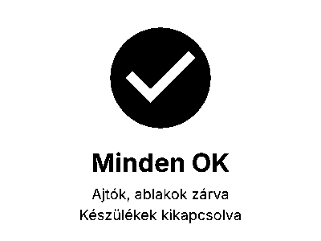
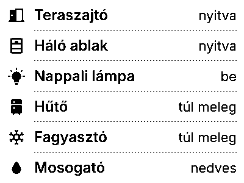
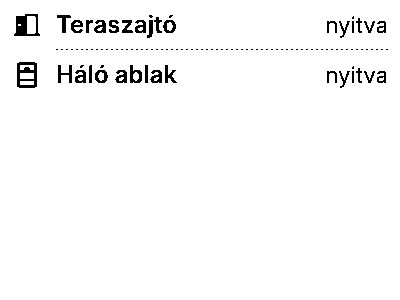
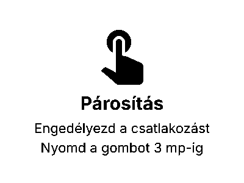
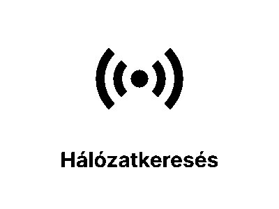
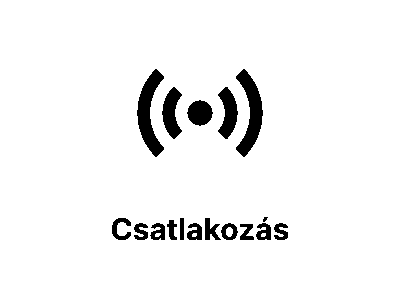
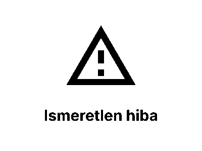

# UI spec

What the screen shows, why, and the exact geometry and type to draw it. The images in [mockups/](mockups/) are
the accepted designs at actual size (400 x 300, 1 bit); the firmware is checked against them. When
each screen is shown and how the firmware builds it are in [display.md](../display.md). How the data is gathered,
filtered and sent is out of scope ([data-model.md](../data-model.md), [home-assistant.md](../home-assistant.md)).

All text on the panel is Hungarian. It is quoted here as it appears; everything else is in English.

The device sits next to the alarm panel and answers one question: "OK to arm and leave?"

## Principles

**Glanceable.** The display must be understood at a glance from across the room, without glasses and without
knowing the system. Three situations must look different from each other and be impossible to mistake:

| Situation | Look | Screens |
|---|---|---|
| All OK, ready to arm | one large solid black shape in the centre | [All OK](#all-ok) |
| Not ready to arm | a list of rows filling the screen | [Problems](#problems) |
| Device needs attention | one large outline icon and a single word line | [Device screens](#device-screens) |

*All OK* is told apart before anything is read: every other screen is mostly white with plain or outline icons.
The staleness indicator must be glanceable too, but not obtrusive.

**Readable.** The problem list uses the whole screen, large legible fonts and short texts. When a text does not
fit, the copy is shortened; the font is never made smaller.

**Clean.** Show the minimum needed. Nothing goes on the screen just because it could; whatever can be removed
while the screen still does its job is removed. So there is no header, no clock, no battery gauge and no
signal strength on any screen.

**Zero learning curve.** It is an appliance for the family: every screen explains itself.

## Panel

4.2", 400 x 300, landscape, 1 bit: pure black and white, no grey. A white bezel may surround the active area, so
large black areas stay away from the edges.

## House screens

### All OK

A large solid black `check-circle` in the centre, "Minden OK" below it, then two fixed detail lines ("Ajtók,
ablakok zárva": doors and windows closed; "Készülékek kikapcsolva": appliances off). It is the only large black
shape on any screen, so it reads as "OK to arm" from across the room.

<table>
<tr><td></td></tr>
</table>

### Problems

Up to 6 problem rows fill the screen from top to bottom: the line icon on the left, the name in semibold, the
state in regular weight right-aligned, dotted separators between rows. With fewer problems the rows start at the
top and the rest stays blank; the rows never spread out or grow.

<table>
<tr><td></td><td></td></tr>
</table>

With more than 6 problems, 5 rows are shown and the sixth says "további N" (N more) with the `dots-horizontal`
icon and no state: 9 problems give "további 4".

<table>
<tr><td></td></tr>
</table>

### Stale data

When the shown data is stale ([staleness flag](../data-model.md#staleness-flag)), a small inverted `sync` badge is
drawn over the top-right corner: white arrows on a black disc, with a white ring that separates it from what is
underneath. Its right edge lines up with the end of the states and separators, and it is centred vertically on
the first row's icon. It may cover the end of the first row's state; nothing else moves. With fresh data there is
no badge.

<table>
<tr><td></td><td></td></tr>
</table>

## Device screens

A large outline icon, centred, with one line of bold text below; no header and no stale badge. Outline icons keep these screens apart from the
solid check of *All OK*, and the single centred line keeps them apart from the problem list. The *Pairing* screen
adds two instruction lines under the title, with a slightly smaller icon, because it is the one screen that asks
the user to act.

| Screen | Situation | Icon | Text |
|---|---|---|---|
| Pairing | not paired: out of the box, and after a failed pairing attempt | `gesture-tap-hold` | Párosítás / Engedélyezd a csatlakozást / Nyomd a gombot 3 mp-ig (Pairing / Allow joining / Hold the button for 3 s) |
| Network search | Zigbee pairing | `access-point` | Hálózatkeresés (searching for network) |
| Connecting | Zigbee interview | `access-point` | Csatlakozás (joining) |
| Synchronizing | waiting for data from HA | `sync` | Szinkronizálás (syncing) |
| Join failed | a paired device failed to rejoin its network | `alert-outline` | Csatlakozási hiba (connection error) |
| Battery dead | battery dead | `battery-outline` | Akkumulátor lemerült (battery dead) |
| Unknown error | any other failure | `alert-outline` | Ismeretlen hiba (unknown error) |

A failed pairing attempt goes back to *Pairing*, which says what to do; *Join failed* is only for a paired device.

<table>
<tr><td></td><td></td></tr>
<tr><td></td><td></td></tr>
<tr><td></td><td></td></tr>
<tr><td></td></tr>
</table>

## Layout and type

Coordinates in pixels from the top-left corner. Text is placed by its baseline; an icon by the top-left corner of
its box (the 24-unit MDI viewBox scaled to the icon size). Font: Inter 4.0 (the static OTF instances); icons:
Material Design Icons 7.4.47.

**All OK**

| Element | Type / size | Position |
|---|---|---|
| `check-circle` | 150 px, solid | box at (125, 22) |
| "Minden OK" | Inter Bold (700) 32 px | centred on x 200, baseline 214 |
| Detail lines | Inter Regular (400) 18 px | centred, baselines 248 and 274 |

**Problems** (row *i* = 0..5, top *t* = 50 *i*)

| Element | Type / size | Position |
|---|---|---|
| Row | 50 px tall, 6 rows fill the height | top *t* |
| Line icon | 30 px | x 12, vertically centred in the row (box top *t* + 10) |
| Name | Inter SemiBold (600) 24 px | x 56, baseline *t* + 33 |
| State | Inter Regular (400) 22 px | right-aligned at x 388, baseline *t* + 33 |
| Separator | 1 px dotted, 2 px on, 3 px off, starting on at x 56 | x 56 to 388, y *t* + 49, between rows only |

**Stale badge** (both house screens)

| Element | Type / size | Position |
|---|---|---|
| Disc | black, radius 17 | right edge at x 388, centre y 25 (centre (371, 25)) |
| Ring | white, 4 px wide around the disc | |
| `sync` | 24 px, white | centred on the disc |

**Device screens**

| Element | Type / size | Position |
|---|---|---|
| Icon | 150 px, outline | centred on x 200, box top y 38 |
| Text | Inter Bold (700) 30 px | centred, baseline 240 |

**Pairing**

| Element | Type / size | Position |
|---|---|---|
| `gesture-tap-hold` | 120 px | centred on x 200, box top y 24 |
| "Párosítás" | Inter Bold (700) 30 px | centred, baseline 180 |
| Instruction lines | Inter Regular (400) 22 px | centred, baselines 218 and 250 |

## Rules

- **Short texts.** A problem row is a short name and a one- or two-word state ("Hűtő | túl meleg": fridge, too
  warm), no values, units or details, so every row fits on one line.
- **No alert markers on icons.** The device is an alert device already: no exclamation marks and no `-alert` icon
  variants (`fridge`, not `fridge-alert`). The only alert-style icons are the fallback line icon
  (`alert-circle`) and the two error screens.
- **Icons**: Material Design Icons 7.4.47 only, the set HA uses; names and codepoints are checked against that
  version. The line icons and their ids are in
  [data-model.md](../data-model.md#line-icons); most are there so new kinds of sensors need no reflash.
  [mockups/icons.html](mockups/icons.html) shows each one large and at its 30 px panel size (open it in a
  browser).

## Making a mockup

Draw the screen as SVG at 400 x 300 with the [layout and type](#layout-and-type) above (text in Inter, icons as
MDI path data scaled from their 24-unit size), rasterise it to anti-aliased grey, and threshold it to 1 bit: grey
above 150/255 becomes white, the rest black. Save it as a PNG at actual size, with no frame or border. The
accepted mockups were rasterised with librsvg 2.58 (`rsvg-convert -w 400 -h 300`) and thresholded with Pillow.

[tools/gen_mockups.py](../../tools/gen_mockups.py) does this from [mockups/screens.json](mockups/screens.json),
which holds the content of every mockup, and prints how many pixels each render differs from the accepted
mockup. It rasterises with resvg (pip-installable, no system libraries): every position and text extent matches
the accepted mockups, with 40 to 200 pixels per screen differing on glyph edges. The mockups are the target
layout, not pixel-exact references: the firmware's own font rendering differs by a pixel here and there as well.

A changed or new screen is added to `screens.json`, rendered, and accepted as a new mockup in
[mockups/](mockups/), named after its `render_screen_t` value (`house_*` for the house screens), together with the
text here that describes it. Then the firmware is
changed to match and checked against it (the `regen-bitmaps` skill).
